# Руководство методиста

## Назначение

Методист готовит всё, по чему преподаватели пишут РПД и ФОС, и проверяет готовые документы: загружает учебные планы и компетенции, закрепляет дисциплины за преподавателями, создаёт и публикует шаблоны, проверяет и принимает документы, назначает согласующих и следит за документом после согласования.

Руководство описывает только то, что доступно роли «Методист». Работа автора документа — редактор, разделы РПД и ФОС, печать — описана в [руководстве преподавателя](teacher.md); методист пользуется им, когда сам создаёт документ.

### Что видно в меню

| Страница | Что на ней делает методист |
| --- | --- |
| «Главная» | Видит сводку и непрочитанные уведомления |
| «Мои документы» | Видит все документы всех авторов, создаёт свои |
| «Проверка» | Видит очередь документов на проверке |
| «Шаблоны» | Создаёт, публикует и архивирует шаблоны РПД и ФОС |
| «Закрепление дисциплин» | Закрепляет дисциплины за преподавателями |
| «Импорт данных» | Загружает учебный план, список и матрицу компетенций |

Справочник сотрудников, кафедры, учётные записи и журнал аудита ведёт администратор. Если подписант не найден или у сотрудника неверная должность, обратитесь к администратору.

Все действия методиста требуют, чтобы учётная запись была связана с записью справочника сотрудников. Иначе система отвечает «Нет записи в справочнике сотрудников» — связь настраивает администратор.

### Порядок работы

1. [Загрузить](#import) учебный план вместе со списком и матрицей компетенций.
2. Привязать [строки матрицы](#matrix-rows), которые система не сопоставила с планом.
3. [Создать и опубликовать](#templates) шаблоны РПД и ФОС для версии плана.
4. При необходимости [закрепить дисциплины](#assignments) за преподавателями.
5. [Проверять](#review) отправленные документы: принимать или возвращать на доработку.
6. Следить за [согласованием](#approval): назначать согласующих, если система их не нашла.

Статусы документа описаны в разделе [«Путь документа и статусы»](teacher.md#document-path) руководства преподавателя.

## Условия работы

Условия те же, что у преподавателя: см. [«Условия работы»](teacher.md#conditions). Для импорта нужны файлы учебного плана (`.xlsx`), списка компетенций (`.docx`) и матрицы компетенций (`.docx`); для шаблона — файл оформления `.docx` с закладками. Каждый файл — до 10 МБ.

## Импорт данных

### Загрузка файлов

На странице «Импорт данных» три поля: «Учебный план — .xlsx», «Список компетенций — .docx», «Матрица компетенций — .docx». Нужны все три файла: кнопка «Загрузить» активна, только когда они выбраны.

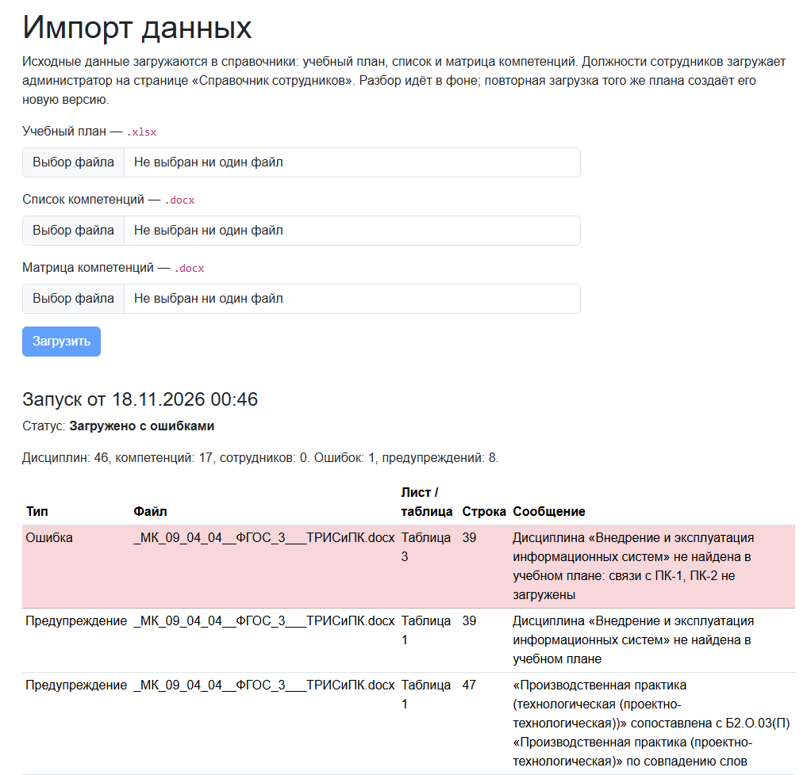

После нажатия «Загрузить» появится «Файлы приняты, идёт разбор…». Разбор идёт в фоне, страницу можно не обновлять: по окончании появится «Импорт завершён: …» со статусом запуска. Импорты выполняются по одному: если кто-то загружает план одновременно с вами, ваш запуск подождёт.

Должности сотрудников (для поиска подписантов) загружает администратор на странице «Справочник сотрудников».

Если файлы не приняты, система пишет «Файлы не приняты:» и называет причину у каждого файла: не то расширение, размер больше допустимого, один и тот же файл в двух полях.

### Результат разбора

Блок «Запуск от …» показывает статус, число дисциплин и компетенций, число ошибок и предупреждений и таблицу замечаний: «Тип», «Файл», «Лист / таблица», «Строка», «Сообщение». Ошибки идут первыми и выделены красным.

| Статус | Что значит |
| --- | --- |
| «Выполняется» | Разбор ещё идёт |
| «Успешно» | План создан, ошибок нет |
| «Загружено с ошибками» | План создан, но часть данных не загружена: прочитайте ошибки |
| «Не выполнено» | План не создан, в справочники ничего не записано |

Список «Последние запуски» показывает 20 последних загрузок; щелчок по строке открывает запуск. Колонка «Сотрудников» у новых запусков равна 0: файл должностей с планом больше не загружается.

### Ошибки и предупреждения разбора

**Ошибка** — данные из этого места не загружены: строка пропущена или связи не созданы. **Предупреждение** — данные загружены, но стоит проверить.

| Сообщение (начало) | Что делать |
| --- | --- |
| «Нет листа «Титул»», «Не найден код направления подготовки», «Не определена форма обучения», «Не найден год начала подготовки» | Файл плана не того вида: выгрузите план заново. Без этих сведений план не создаётся |
| «Не найдена направленность (профиль)» | Без профиля план не создаётся, хотя сообщение помечено предупреждением. Проверьте лист «Титул» |
| «Нет листа «План»», «Не найдена строка заголовков с колонкой «Индекс»», «Не найдены колонки семестров» | Дисциплины или часы не прочитаны: проверьте, что выгружен полный план |
| «…: индекс повторяется — строка пропущена», «…: нет наименования — строка пропущена» | Строка плана не загружена; исправьте план и загрузите его снова |
| «…: сумма з.е. по семестрам … не равна итогу …», «…: контактные часы … не равны итогу …» | План загружен как есть; расхождение видно и в документе |
| «…: нечисловое значение … в ячейке …» | В ячейке текст вместо числа, вместо него подставлен 0 |
| «Компетенция … повторяется», «Индикатор …: нет компетенции …», «Компетенция …: нет формулировки» | Проверьте таблицы списка компетенций |
| «Индикаторов без типа (знать / уметь / владеть): N» | Индикаторы загружены одной формулировкой, без деления на «знать», «уметь», «владеть» |
| «Дисциплины плана … нет в матрице компетенций» | У дисциплины не будет связей с компетенциями, пока строка матрицы не привязана |
| «… сопоставлена с … по совпадению слов» или «по похожести названия» | Система нашла дисциплину по неточному названию — проверьте, что верно |
| «Дисциплина «…» не найдена в учебном плане: связи с … не загружены», «Дисциплина «…» неоднозначна» | Привяжите строку вручную: [«Привязка строк матрицы»](#matrix-rows) |
| «Направление … не совпадает с направлением учебного плана …» | Файлы компетенций от другого направления. Загрузка не останавливается — загрузите верный комплект заново |
| «Кафедра «…» — та же, что «…» в справочнике», «…исправлено вручную…; оставлено исправленное» | Импорт не перезаписывает название кафедры, исправленное администратором |
| «Импорт прерван: …» | Сбой при записи: повторите загрузку, если не помогло — сообщите администратору |

### Привязка строк матрицы

В матрице компетенций у дисциплин нет индексов — только названия. Система ищет дисциплину плана по точному названию, затем по набору слов, затем по похожести, а при нескольких подходящих уточняет по семестрам. Строку, которую так найти не удалось, система показывает в блоке «Строки матрицы без дисциплины плана» под результатом запуска.

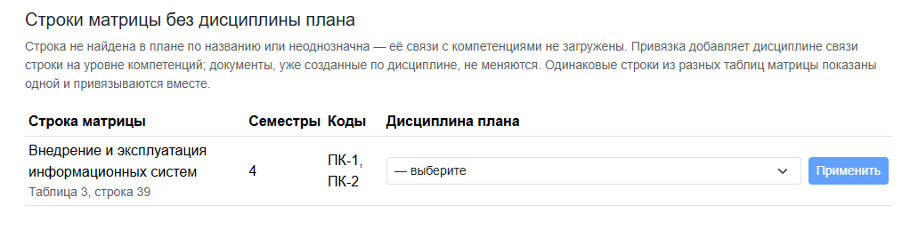

1. В колонке «Дисциплина плана» выберите дисциплину. Вверху списка — кандидаты, ниже — уже привязанные в этом блоке и дисциплины без связей с матрицей. Если строка не относится ни к одной дисциплине, выберите «Не учитывать».
2. Нажмите «Применить». Появится «Строка «…» привязана.»; если какой-то компетенции строки нет в списке компетенций плана, система назовёт её.
3. Ошибочную привязку отменяет кнопка «Отменить» — она удаляет только связи, добавленные этой привязкой.

Привязка добавляет дисциплине связи с компетенциями без индикаторов. Документы, уже созданные по дисциплине, не меняются: связи увидят новые документы. Одинаковые строки из разных таблиц матрицы показаны одной строкой и привязываются вместе. Привязка относится к версии плана, созданной этим запуском; строки прежнего запуска можно привязать, открыв его в «Последних запусках».

### Новая версия учебного плана

Каждая загрузка создаёт новую версию плана — даже если план тот же. Прежние версии, их документы и закрепления не меняются и не удаляются.

- **Шаблоны** привязаны к одной версии плана: для новой версии нужен свой шаблон.
- **Закрепления** на новую версию не переносятся.
- **Документ** по новой версии можно создать «на основе» документа прежней версии — см. [«Создание на основе другого документа»](teacher.md#create-based).

В названии плана — код и направление, профиль, год набора и номер версии, например «09.04.04 Программная инженерия — …, набор 2023, версия 4». Форма обучения в названии не видна.

## Закрепление дисциплин

Закреплённый за дисциплиной преподаватель видит её документы только для чтения и создаёт по ней РПД и ФОС, в том числе на основе чужих. Пока за дисциплиной никого нет, РПД по ней создаёт любой преподаватель; с первым закреплением — только закреплённые. Правит документ только его автор.

### Как закрепить

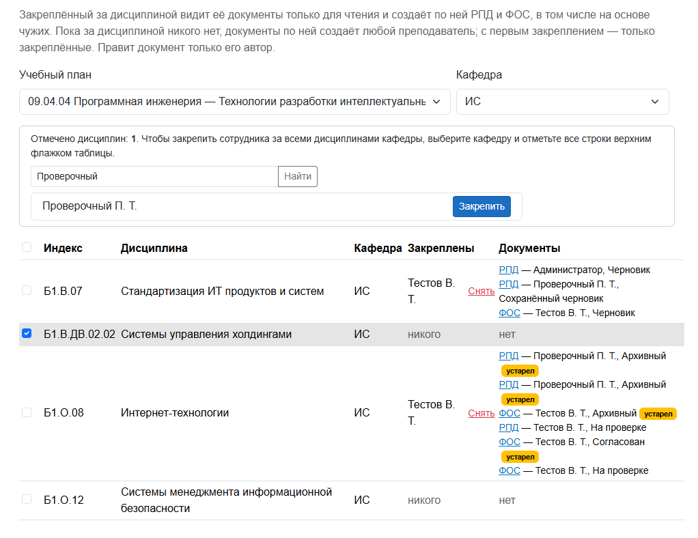

1. Выберите «Учебный план» и, если нужно, «Кафедру».
2. Отметьте дисциплины флажками. Чтобы закрепить преподавателя за всеми дисциплинами кафедры, выберите кафедру и отметьте все строки верхним флажком.
3. Введите фамилию и нажмите «Найти». Ищутся только сотрудники с действующей учётной записью преподавателя.
4. Нажмите «Закрепить» у нужного сотрудника и подтвердите.

В таблице только дисциплины и факультативы: модулей, практик и ГИА в ней нет — документ для них не создаётся. Колонка «Документы» показывает уже созданные РПД и ФОС дисциплины: автора, статус и отметку «устарел».

Если сотрудника нет в поиске, у него нет учётной записи с ролью «Преподаватель» — её создаёт администратор на странице «Пользователи».

### Снятие закрепления

Кнопка «Снять» рядом с фамилией в колонке «Закреплены». Снятый преподаватель больше не видит чужие документы дисциплины и не создаёт по ней новые; свои документы остаются при нём. Если снято последнее закрепление, дисциплина снова открыта всем преподавателям.

### Правила закрепления

- За дисциплиной можно закрепить несколько преподавателей; снимают их по одному.
- Закрепление действует сразу на РПД и ФОС. ФОС создаёт автор РПД и закреплённые преподаватели.
- Методист и администратор создают документы по любой дисциплине, закрепления их не ограничивают.
- Преподаватель, не закреплённый за дисциплиной, получит при создании «Дисциплина закреплена» со списком закреплённых.
- Уже созданные документы других авторов остаются, их авторы продолжают работу.
- Если документ [передан](#transfer) другому автору, а у дисциплины есть закрепления, новый автор закрепляется автоматически.
- Закреплённому приходит уведомление «Вам закреплена дисциплина», снятому — «Закрепление дисциплины снято».

## Шаблоны документов

Шаблон задаёт для версии учебного плана структуру документа, его оформление в печати, постоянные пункты вуза и лист согласования. Документы создаются только по опубликованному шаблону и только для дисциплин его плана.

### Список шаблонов

На странице «Шаблоны» — фильтры «Тип», «Статус», «Учебный план» и таблица: «Название», «Тип», «Учебный план», «Редакция», «Статус». Новые шаблоны — сверху. Щелчок по строке открывает карточку шаблона.

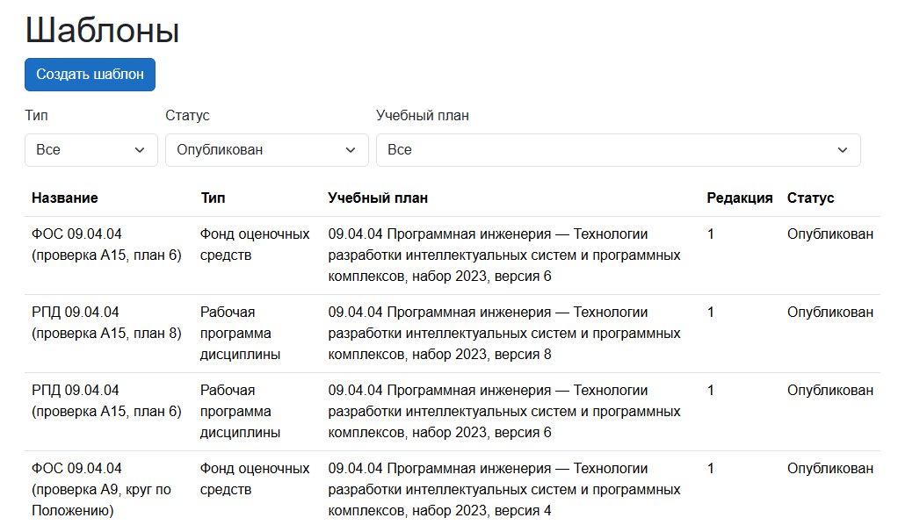

| Статус | Что можно сделать |
| --- | --- |
| Пустой | Загрузить файл оформления, удалить |
| Черновик | Заменить файл, изменить значения по умолчанию, «Сохранить», «Опубликовать», удалить |
| Сохранённый черновик | «Опубликовать», удалить; замена файла или значений по умолчанию возвращает статус «Черновик» |
| Опубликован | «Новая редакция», «Архивировать» |
| Архивный | Только просмотр |

Преподаватели и согласующие видят список и карточки только для чтения.

### Создание шаблона

1. На странице «Шаблоны» нажмите «Создать шаблон».
2. Выберите «Тип документа» (РПД или ФОС), введите «Название» и выберите «Учебный план».
3. Нажмите «Создать». Откроется карточка шаблона в статусе «Пустой» с подсказкой «Шаблон создан. Загрузите DOCX-шаблон оформления.»

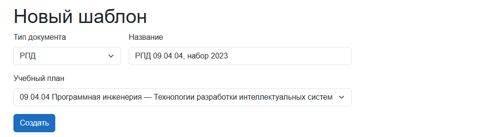

Название и план после создания не меняются. Если планов в списке нет, сначала загрузите план на странице [«Импорт данных»](#import).

При создании шаблон получает текущую структуру документа, лист согласования и значения по умолчанию. Поэтому новые возможности — например, обязательное наименование раздела в РПД и согласование ФОС председателем УМК — есть только у шаблонов, созданных после их появления. Новая редакция старого шаблона их не получит: создайте новый шаблон.

### Файл оформления

Файл оформления — документ Word (`.docx`) с закладками, имена которых начинаются с `Autofill`. В места закладок система подставляет данные при печати. Закладки ищутся в тексте, колонтитулах и сносках. Числовой хвост имени не учитывается: `AutofillName1` и `AutofillName2` — два места одной закладки `AutofillName`.

Выберите файл в поле «DOCX-шаблон оформления с закладками Autofill» и нажмите «Загрузить». Появится «Шаблон оформления загружен.», статус станет «Черновик». Загруженный файл можно скачать кнопкой «Скачать» рядом с его именем.

| Сообщение | Причина |
| --- | --- |
| «Нужен файл .docx» | Выбран файл другого формата |
| «Недопустимый размер файла» | Файл пустой или больше 10 МБ |
| «Файл не читается как документ Word» | Файл повреждён или сохранён не как `.docx` |

### Сопоставление закладок

При загрузке система сама сопоставляет закладки с данными: полями документа, данными плана и справочников, подписями листа согласования, таблицами, оглавлением. Раздел «Закладки шаблона оформления» показывает итог («Закладок: N, вхождений: N, не сопоставлено: N…») и таблицу: «Закладка», «Вхождений», «Сопоставлена», «Вид цели», «Цель», «Особые вхождения», «Пояснение». Несопоставленная закладка выделена красным.

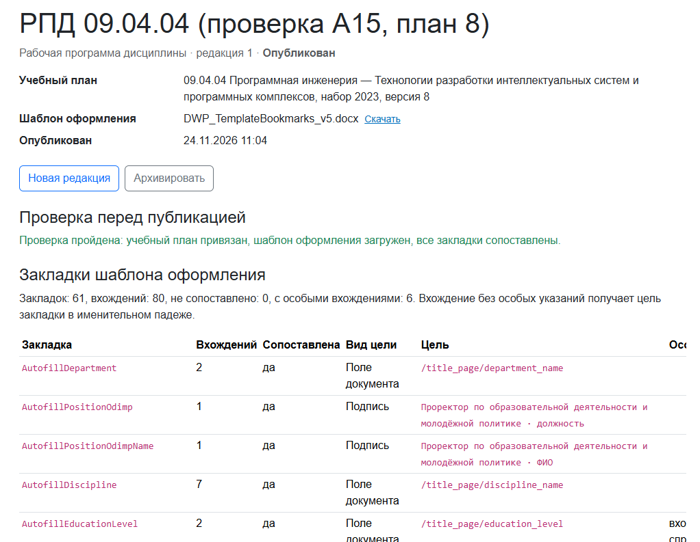

**Особые вхождения** — места закладки с другой формой слова или своей целью, например «вхождение 2: дательный падеж». Вхождение без особых указаний получает данные в именительном падеже.

Сопоставление на странице не редактируется. Если закладка не сопоставлена, переименуйте или уберите её в файле Word и загрузите файл снова. Имена закладок, которые знает система, — в карточке любого опубликованного шаблона того же типа.

### Проверка перед публикацией

Раздел «Проверка перед публикацией» обновляется при каждом открытии карточки. Если всё в порядке, он пишет «Проверка пройдена: учебный план привязан, шаблон оформления загружен, все закладки сопоставлены.»; иначе — красный список ошибок.

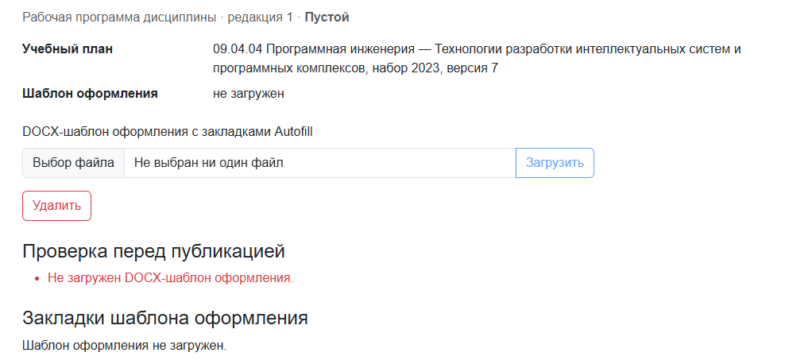

| Ошибка | Что делать |
| --- | --- |
| «Не загружен DOCX-шаблон оформления.» | Загрузите файл оформления |
| «В шаблоне оформления нет закладок Autofill.» | Добавьте закладки в файл Word |
| «Закладка … не сопоставлена» | Переименуйте или уберите закладку и загрузите файл снова |
| «Закладка …: …» с причиной | Закладка указывает на данные, которых в документе нет; сверьте имя с образцом |

### Значения по умолчанию

Раздел «Значения по умолчанию» есть у шаблонов РПД. Это постоянные пункты вуза: виды самостоятельной работы, интернет-ресурсы, методические указания, программное обеспечение, материально-техническое обеспечение. Новый документ получает их заполненными, автор дополняет и удаляет пункты. В печати пункты по умолчанию и пункты автора — один список с единой нумерацией.

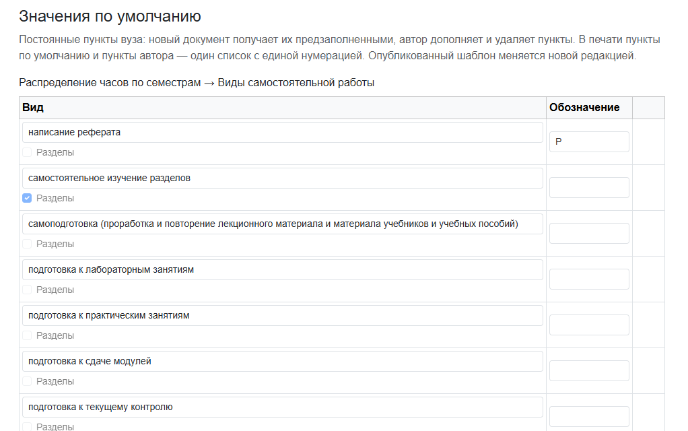

Измените пункты и нажмите «Сохранить значения по умолчанию»; «Сохранить» и «Опубликовать» шаблона сохраняют их тоже. Если уйти со страницы, не сохранив, система спросит «Значения по умолчанию не сохранены. Уйти со страницы?».

Значения попадают только в документы, созданные после сохранения. У опубликованного шаблона они меняются [новой редакцией](#template-revision).

### Лист согласования

Раздел «Лист согласования» показывает места подписей: «Место», «Категория», «Правило определения», «Согласование» (электронно или на бумаге), «Размещение». На странице он не редактируется.

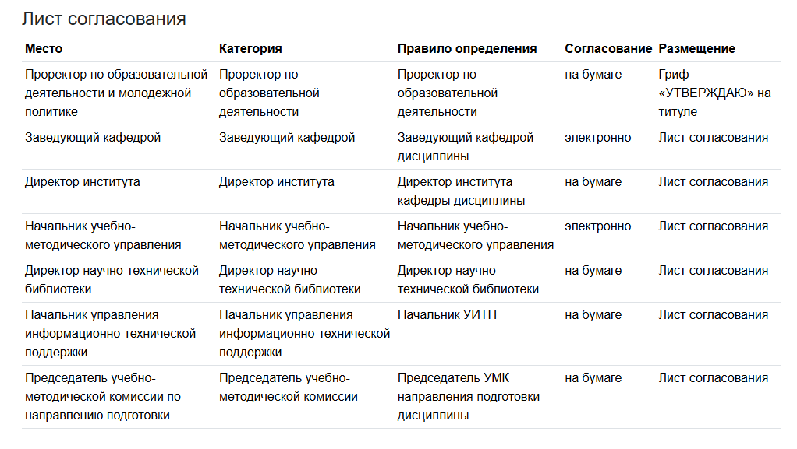

- **РПД** электронно согласуют заведующий кафедрой дисциплины и начальник учебно-методического управления.
- **ФОС** (шаблоны, созданные после перехода на Положение о ФОС) — председатель учебно-методической комиссии направления и начальник учебно-методического управления. Заведующий кафедрой подписывает ФОС только на бумаге.

Остальные места печатаются для подписи на бумаге. Как система находит согласующих — в разделе [«Назначение согласующих»](#assign-approvers).

### Публикация

«Сохранить» переводит черновик в «Сохранённый черновик» — это отметка «готов, но не опубликован»; для публикации она не обязательна. «Опубликовать» проверяет шаблон и делает его доступным преподавателям: «Шаблон опубликован.». Если проверка не пройдена, система пишет «Шаблон не прошёл проверку перед публикацией» и перечисляет ошибки.

Опубликованный шаблон не меняется: ни файл, ни значения по умолчанию. Изменения — только новой редакцией.

### Новая редакция

«Новая редакция» у опубликованного шаблона создаёт черновик со следующим номером редакции — копию прежней: файл, закладки, значения по умолчанию, лист согласования. Измените в нём что нужно и опубликуйте. Пока новая редакция не опубликована, документы создаются по прежней.

При публикации новой редакции:
- прежняя редакция становится «Архивный»;
- документы прежних редакций получают отметку «устарел». Отметка не мешает их править, отправлять и согласовывать; авторам уведомление не приходит.

Документ прежней редакции по-прежнему занимает дисциплину: второй документ по ней создаётся «на основе» прежнего. Дисциплину освобождает отправка документа в [архив](#archive).

Одновременно может быть только одна неопубликованная редакция: «Новая редакция уже в работе» — продолжите её или удалите.

### Архив и удаление шаблона

- **«Архивировать»** — у опубликованного шаблона, без подтверждения. Документы по нему больше не создаются, созданные не меняются и отметку «устарел» не получают. Вернуть шаблон из архива и создать от него новую редакцию нельзя — останется создать новый шаблон.
- **«Удалить»** — у пустого шаблона и черновика, с подтверждением. Удалённый шаблон пропадает из списков.

## Проверка документов

### Очередь проверки

Страница «Проверка» — «Документы на проверке»: «Отправлен», «Дисциплина», «Тип», «Автор», «План». Ранние — сверху. Документ, который вернул согласующий или администратор, помечен «с согласования» и строкой «возврат: …» с фамилией и временем.

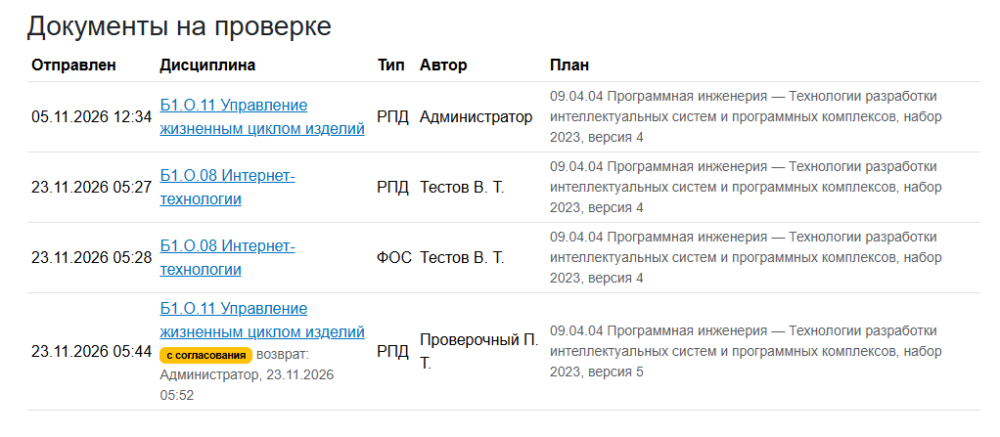

О каждом отправленном документе всем методистам приходит уведомление «Отправлен на проверку» или «Повторно отправлен на проверку». Почта о нём по умолчанию выключена — включается в [настройке уведомлений](teacher.md#notification-settings).

Документ на проверке может открыть любой методист: проверка не закрепляется за одним из них.

### Страница документа у методиста

Документ «На проверке» методист видит с кнопками «Сохранить», «Сохранить и выйти», «Принять», «Вернуть на доработку», «Передать документ», у РПД — ещё «Создать ФОС». Ниже — «Печатная форма», панель «Согласование» (если документ уже бывал на согласовании), «История» и сводка «Замечания к полям».

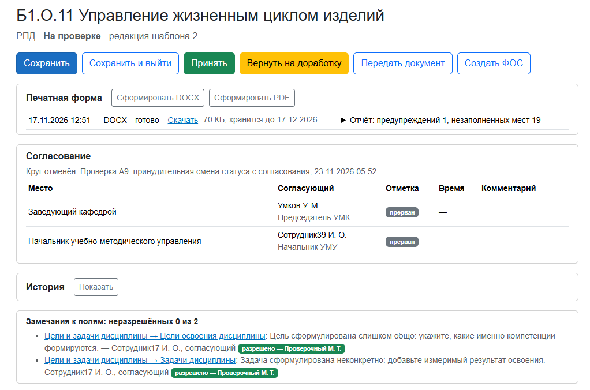

Разделы, поля, проверка системой и печать устроены так же, как у автора: см. [«Редактор документа»](teacher.md#editor), [«Проверка документа системой»](teacher.md#check) и [«Печать»](teacher.md#print).

### Взять на проверку

Документ, который автор не отправил, — черновик или документ «На доработке» — методист может взять на проверку сам: например, если автор в отпуске, а исправления небольшие. Найдите документ в «Моих документах», нажмите «Взять на проверку», укажите причину и нажмите «Взять».

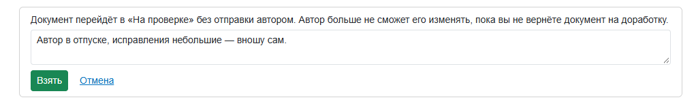

Документ перейдёт в «На проверке», автор больше не сможет его изменять, пока вы не вернёте документ на доработку. Автору придёт уведомление с причиной, а если документ открыт у него на экране — при следующем сохранении он увидит «Документ взят на проверку методистом.»; введённое останется на его экране. Проверка системой при взятии не выполняется — она будет при приёме.

### Замечания к полям и записям

Замечание оставляют у поля: ссылка «+ замечание», текст «Что нужно исправить», кнопка «Добавить замечание». У списков — темы тематического плана, литературы, заданий — в форме есть выбор «к полю целиком» или к одной записи («№ 1 — …»). Замечание к записи следует за ней, если автор переставит записи, а если запись удалят — помечается «запись удалена».

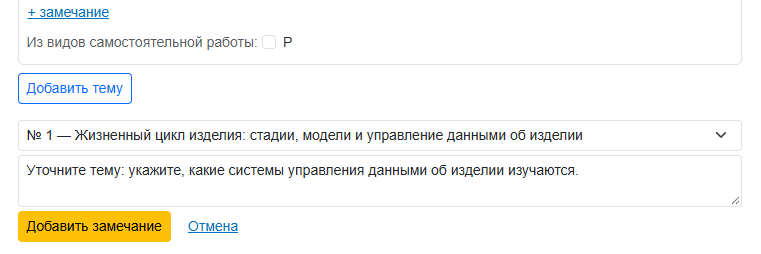

Несохранённые изменения раздела сохраняются перед добавлением замечания.

Замечания не удаляются — это история проверки. Исправленное отмечают кнопкой «Разрешено» у поля: методист — свои замечания и замечания согласующих, автор — все замечания на доработке. Сводка «Замечания к полям: неразрешённых N из M» вверху документа ведёт к полям; на кнопках разделов — значок с числом замечаний.

### Возврат на доработку

Нажмите «Вернуть на доработку»: панель покажет число неразрешённых замечаний. Вернуть документ можно только с замечаниями — без них кнопка «Вернуть автору» неактивна. Общий комментарий необязателен.

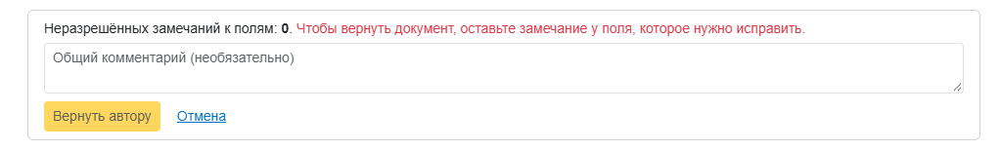

Документ станет «На доработке», автор получит уведомление с числом замечаний и комментарием. Учитываются все неразрешённые замечания документа, в том числе замечания согласующих.

### Правка документа и данных плана

На проверке методист может исправить любое содержимое документа сам — кнопки «Сохранить» и «Сохранить и выйти», автосохранение работает как у автора. Статус при этом не меняется.

Поля из учебного плана (значок «из учебного плана») автор не правит. Методист и администратор исправляют их в документах «На проверке» и «Принят» — когда дешевле поправить документ, чем план. Чаще всего это часы и виды аттестации в таблице «Распределение часов по семестрам».

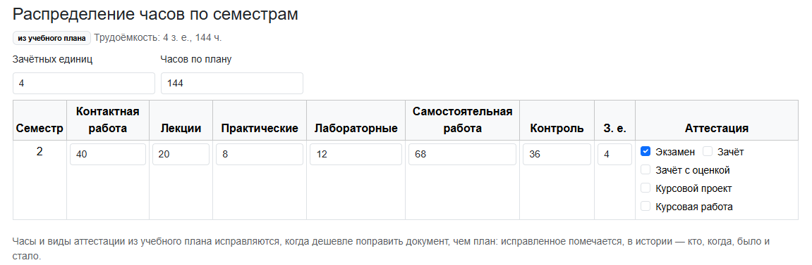

- Исправление поля плана сохраняется сразу. У поля появится «изменено методистом, в плане: …», в документе — карточка «Исправления полей из учебного плана» (кто, когда, было и стало), в [истории](#history) — запись «Исправлено поле из учебного плана».
- Контактные часы пересчитываются сами; вид курсового проектирования следует из аттестации.
- В принятом документе, кроме полей плана, ничего не правится. Если после исправления документ не проходит проверку, система спросит «Вернуть документ автору на доработку?»: «Нет» отменит исправление, «Да» вернёт документ автору с замечаниями «После исправления данных плана: …».

У ФОС на проверке есть «Обновить из РПД» — то же, что у автора: см. [«Обновление из РПД»](teacher.md#fos-refresh).

### Сквозная проверка РПД ↔ ФОС

В ФОС под плашкой «Создан по РПД» — блок «Сквозная проверка РПД ↔ ФОС: расхождений N». Пункты сгруппированы по правилам, ссылка «→ …» ведёт к разделу ФОС. В РПД список «ФОС по этой РПД» показывает число расхождений у каждого ФОС.

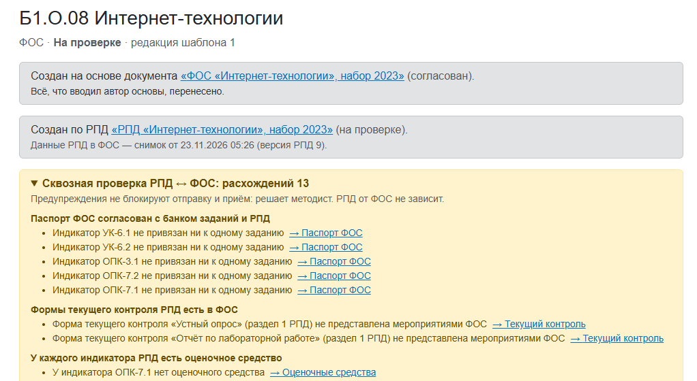

| Правило | Вид |
| --- | --- |
| «Статус связанной РПД»: ФОС отправляется, когда РПД на проверке, принята, на согласовании или согласована | Ошибка: не даёт отправить и принять ФОС |
| «У каждого индикатора РПД есть оценочное средство» | Предупреждение |
| «Паспорт ФОС согласован с банком заданий и РПД» | Предупреждение |
| «Аттестация и шкала соответствуют виду аттестации РПД» | Предупреждение |
| «Формы текущего контроля РПД есть в ФОС» | Предупреждение |
| «Пороги Положения о ФОС»: вопросов не меньше 20, тестовых заданий не меньше 10, билетов не меньше 25 | Предупреждение |

Предупреждения не блокируют отправку и приём — решает методист: принять ФОС или оставить замечания и вернуть. РПД от ФОС не зависит.

## Приём и согласование

### Приём документа

Нажмите «Принять». Окно «Принять документ» скажет, что будет дальше:

- «Вы отправляете документ на согласование. Уверены?» — все согласующие найдены;
- «Подписанты не найдены у мест: … Документ станет «Принят», согласование начнётся после назначения согласующих.» — см. [«Назначение согласующих»](#assign-approvers);
- у ФОС в начале — число расхождений сквозной проверки: приём они не блокируют.

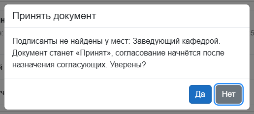

Система не примет документ, если:
- есть неразрешённые замечания — «Есть неразрешённые замечания»: отметьте исправленные кнопкой «Разрешено» или верните документ автору. Замечания другого методиста снимает только автор — такой документ возвращают на доработку;
- полная проверка находит ошибки — «Документ не прошёл проверку» со списком ссылок на поля: исправьте сами или оставьте замечания и верните. Предупреждения приём не блокируют.

После приёма система сама начинает согласование: «Документ принят. Документ отправлен на согласование.» Если в листе согласования нет электронных мест, документ сразу «Согласован». Если согласующие найдены не все, документ остаётся «Принят» — какие места пустые, видно в панели «Согласование». Автор получает уведомление «Принят».

### Назначение согласующих

Электронные места берутся из листа согласования шаблона, согласующие — из справочника сотрудников:

| Место | Кого ищет система |
| --- | --- |
| Заведующий кафедрой | Заведующего кафедрой дисциплины, если его нет — исполняющего обязанности |
| Председатель УМК | Председателя учебно-методической комиссии направления плана |
| Начальник учебно-методического управления | Сотрудника с этой должностью |

Ищутся только действующие записи справочника. Если у дисциплины нет кафедры или в справочнике нет нужной должности, место остаётся пустым: «не найден в справочнике».

Пустое место заполняют вручную ссылкой «Назначить», согласующего, который ещё не отметился, заменяют ссылкой «Заменить». Введите фамилию, нажмите «Найти» и «Назначить» у нужного сотрудника: «Согласующий назначен: …».

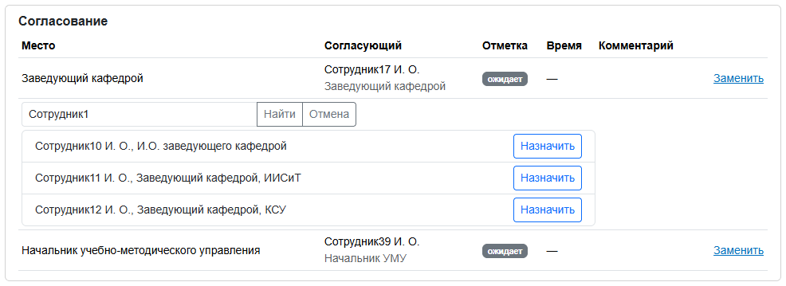

- Назначить и заменить можно в статусах «Принят» и «На согласовании», пока отметка места «ожидает».
- Сотрудник без учётной записи с ролью «Утверждающий» назначается, но панель предупредит: «нет учётной записи с ролью «Утверждающий» — отметить не сможет». Учётную запись создаёт администратор.
- При замене на идущем согласовании новому согласующему приходит «Ждёт вашего согласования», прежнему — «Согласующий заменён».

Если согласующий не найден из-за ошибки в справочнике (неверная должность, кафедра), сообщите администратору: назначение вручную действует только для этого документа.

### Запуск согласования

Когда все места документа «Принят» заполнены, под таблицей появится «Согласующие назначены — согласование запускает методист.» и кнопка «Запустить согласование». После подтверждения — «Документ отправлен на согласование.», согласующим и автору приходят уведомления.

Согласующие отмечают документ независимо, порядок не важен. Когда отметились все, документ «Согласован», методистам и автору приходит уведомление. Что видит и делает согласующий, описано в разделе [«Согласующему»](teacher.md#approver).

### Возврат с согласования

Согласующий может вернуть документ кнопкой «Вернуть на проверку» — с комментарием и замечаниями к полям. Документ снова «На проверке» с пометкой «с согласования» в очереди, согласование прервано: остальным согласующим приходит «Круг согласования прерван», методистам — «Возвращён с согласования» (почта о нём по умолчанию включена).

В документе — плашка «Возвращён с согласования» с фамилией, временем и комментарием. Дальше два пути:

- **исправить самому:** внести исправления, отметить замечания согласующего «Разрешено» и принять документ;
- **вернуть автору:** оставить документ с замечаниями и [вернуть на доработку](#return) — замечания согласующего разрешит автор.

Новый приём начнёт согласование заново, для всех согласующих. Отметки прерванного круга остаются в панели серыми с подписью «Круг отменён».

## История документа

Карточка «История» на странице документа есть у методиста и администратора. Она свёрнута: нажмите «Показать». Записи — от новых к старым, по 50, дальше — «Показать ещё». «Обновить» перечитывает историю.

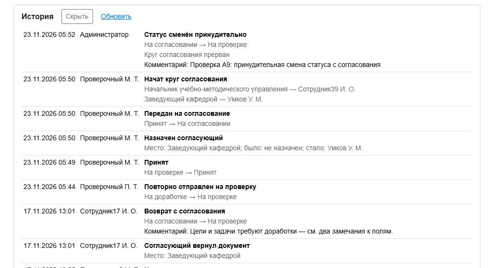

В каждой записи — время, кто, событие, смена статуса и подробности:

- **статусы:** создание, сохранение, отправка и повторная отправка, взятие на проверку, возврат на доработку, приём, передача на согласование, возврат с согласования, согласование, архив;
- **действия:** исправление поля из учебного плана, назначение согласующего, начало круга, отметки согласующих, возврат на исправление, принудительная смена статуса, передача другому автору, создание на основе, обновление снимка РПД, отметка «устарел».

Комментарии и причины действий показаны в строке «Комментарий: …». Самих замечаний к полям в истории нет — они в сводке «Замечания к полям». Записи по всем документам сразу администратор смотрит на странице «Журнал аудита».

## После согласования

### Возврат на исправление

Согласованный документ закрыт для правок. Если в нём нашлась ошибка, нажмите «Вернуть на исправление», укажите причину — она попадёт в историю и в уведомление — и нажмите «Вернуть».

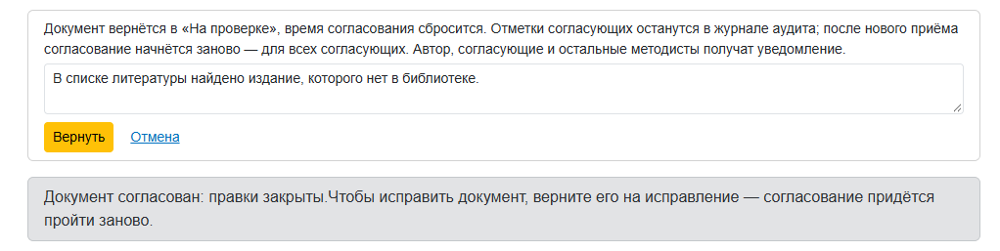

Документ вернётся «На проверке», время согласования сбросится, а после нового приёма согласование начнётся заново — для всех согласующих. Автор, согласующие и другие методисты получат уведомление; в панели «Согласование» появится «Круг отменён: <причина>».

Вернуть документ нельзя, если по той же дисциплине и шаблону уже есть другой незавершённый документ: «Есть незавершённый документ». Сначала его согласуют, отправят в архив или удалят.

### Архив

«В архив» у согласованного документа доступна автору, методисту и администратору. Архивный документ только для чтения, а дисциплина свободна для нового документа. Из архива документ возвращает только администратор.

- Вместе с РПД в архив уходят её согласованные ФОС.
- РПД не уходит в архив, пока по ней есть незавершённый ФОС: «Есть незавершённый ФОС». Согласуйте его, отправьте в архив или удалите.
- Автор получает уведомление «Отправлен в архив».

Отметка «устарел» описана в разделе [«Устаревший документ»](teacher.md#outdated).

### Передача документа

Если автор уволился или дисциплину передали другому преподавателю, документ передают новому автору. «Передать документ» есть у методиста и администратора в любом статусе.

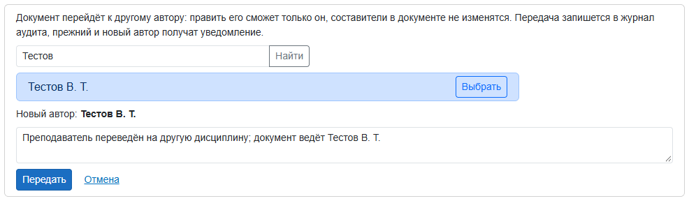

1. Нажмите «Передать документ».
2. Введите фамилию нового автора, «Найти», «Выбрать». Ищутся преподаватели с действующей учётной записью.
3. Укажите причину — она попадёт в журнал аудита и в уведомления.
4. Нажмите «Передать» и подтвердите.

Править документ сможет только новый автор; составители в документе не меняются. Прежний и новый автор получают уведомления. Если у дисциплины есть закрепления, новый автор закрепляется за ней. Прежний автор теряет доступ к документу, если у него нет другого права его видеть — например, закрепления за дисциплиной.

## Мои документы и уведомления

Страница «Мои документы» у методиста показывает все документы всех авторов, кроме удалённых: фильтры «Статус» и «Учебный план», колонки «Дисциплина», «Тип», «Статус», «Изменён», «Автор». Здесь находят документ, который нужно взять на проверку, вернуть на исправление или передать.

Методист сам создаёт РПД и ФОС по любой дисциплине — как преподаватель, см. [«Создание документа»](teacher.md#create); закрепления его не ограничивают.

Уведомления методиста:

| Уведомление | Когда приходит |
| --- | --- |
| «Отправлен на проверку», «Повторно отправлен на проверку» | Автор отправил документ — всем методистам |
| «Возвращён с согласования» | Согласующий вернул документ |
| «Согласован» | Все согласующие отметились |
| «Возвращён на исправление» | Другой методист вернул согласованный документ |
| «Статус документа изменён принудительно» | Администратор сменил статус |
| «На доработке больше N дней» | Автор долго не исправляет документ |
| «Печатная форма готова», «не сформирована» | Печать, запущенная вами, закончилась |

За собственные действия уведомления не приходят. Каналы и почту настраивают в профиле: см. [«Настройка уведомлений»](teacher.md#notification-settings).

## Сообщения системы

Общие сообщения — «Нет связи с сервером», «Документ изменён в другой сессии» и другие — описаны в разделе [«Сообщения системы»](teacher.md#messages) руководства преподавателя.

| Сообщение | Что делать |
| --- | --- |
| «Нет записи в справочнике сотрудников» | Учётная запись не связана со справочником: обратитесь к администратору |
| «Файлы не приняты:» | Проверьте формат и размер файлов, не выбран ли один файл дважды |
| «Импорт завершён: не выполнено.» | Прочитайте ошибки запуска: план не создан |
| «Строка уже привязана. Сначала отмените прежнюю привязку.» | Нажмите «Отменить» у строки и привяжите заново |
| «У сотрудника нет учётной записи преподавателя.» | Учётную запись с ролью «Преподаватель» создаёт администратор |
| «Шаблон не прошёл проверку перед публикацией» | Исправьте перечисленное в разделе «Проверка перед публикацией» |
| «Новая редакция уже в работе.» | Откройте неопубликованную редакцию или удалите её |
| «Для этой дисциплины документ по шаблону уже есть.» | Создайте документ «на основе» прежнего или отправьте прежний в архив |
| «Нет неразрешённых замечаний.» | Возврат на доработку — только с замечаниями: оставьте замечание у поля |
| «Есть неразрешённые замечания.» | Отметьте исправленное «Разрешено» или верните документ автору |
| «Документ не прошёл проверку» | Исправьте ошибки по ссылкам или верните документ с замечаниями |
| «Чужое замечание.» | Замечание другого методиста разрешает автор на доработке |
| «Не все согласующие назначены.» | Назначьте согласующих на пустые места |
| «Отметка уже поставлена.» | Заменить можно только согласующего, который ещё не отметился |
| «Не указана причина.» | Напишите причину: она попадёт в историю и уведомления |
| «Есть незавершённый документ.» | По дисциплине уже есть другой документ в работе |
| «Есть незавершённый ФОС.» | Согласуйте ФОС, отправьте в архив или удалите его |
| «Автор не изменится.» | Документ уже у этого автора |
