# Руководство преподавателя и согласующего

## Назначение системы

Система помогает подготовить рабочую программу дисциплины (РПД) и фонд оценочных средств (ФОС): часть документа заполняется из учебного плана и матрицы компетенций, остальное вводит автор в форме по разделам. Готовый документ проверяет методист, согласуют ответственные лица, а система печатает его в DOCX и PDF по оформлению университета.

Руководство описывает работу преподавателя — автора документа — и согласующего. Раздел [«Согласующему»](#approver) можно читать отдельно.

### Роли и что видно в меню

Роль назначает администратор. Ролей может быть несколько: меню показывает страницы всех ролей пользователя.

| Роль | Страницы меню | Что делает |
| --- | --- | --- |
| Преподаватель | «Главная», «Мои документы», «Шаблоны» | Создаёт, заполняет, отправляет на проверку и печатает РПД и ФОС |
| Утверждающий (согласующий) | «Главная», «Согласование», «Шаблоны» | Отмечает согласие с документом или возвращает его методисту |
| Методист | «Главная», «Мои документы», «Проверка», «Шаблоны», «Закрепление дисциплин», «Импорт данных» | Загружает учебные планы, готовит шаблоны, проверяет документы |

Страница «Шаблоны» преподавателю и согласующему открыта для просмотра: создаёт и публикует шаблоны методист.

### Путь документа и статусы

| Статус | Что это значит | Кто изменяет содержание |
| --- | --- | --- |
| Черновик | Документ создан | Автор |
| Сохранённый черновик | Автор нажал «Сохранить» | Автор |
| На проверке | Документ у методиста | Методист |
| На доработке | Методист вернул документ с замечаниями | Автор |
| Принят | Методист принял документ, но согласование не начато: не назначен согласующий | Никто |
| На согласовании | Документ ждёт отметок согласующих | Никто |
| Согласован | Все электронные согласующие отметили согласие | Никто |
| Архивный | Документ только для чтения, дисциплина свободна для нового документа | Никто |

Обычный путь: «Черновик» → «На проверке» → «На согласовании» → «Согласован». Статус «На доработке» появляется, если у методиста есть замечания. Удалённый документ в списках не показывается.

Отметка «устарел» рядом со статусом — не статус, а предупреждение: см. [«Устаревший документ»](#outdated).

## Условия работы

Нужны компьютер в сети кафедры и браузер: Chrome, Edge, Яндекс Браузер или Firefox последних версий. Устанавливать ничего не нужно. Адрес системы сообщает администратор, он начинается с `https://`.

- **Предупреждение браузера о сертификате** означает, что на компьютере не установлен корневой сертификат системы. Обратитесь к администратору: вводить пароль на странице с таким предупреждением не нужно.
- **Связь с сервером** нужна всё время работы. Если она пропала, появится сообщение «Нет связи с сервером. Повторите позже.» — введённое остаётся на экране, пока страница открыта.
- **Почта** нужна для писем восстановления пароля и уведомлений. На время апробации она может быть выключена: тогда временный пароль выдаёт администратор, а уведомления видны только в системе.
- **Просмотр PDF** на странице документа работает во встроенном просмотрщике браузера.

## Вход и пароль

### Вход в систему

1. Откройте адрес системы и нажмите «Войти» в правом верхнем углу.
2. Введите email учётной записи и пароль, нажмите «Войти».

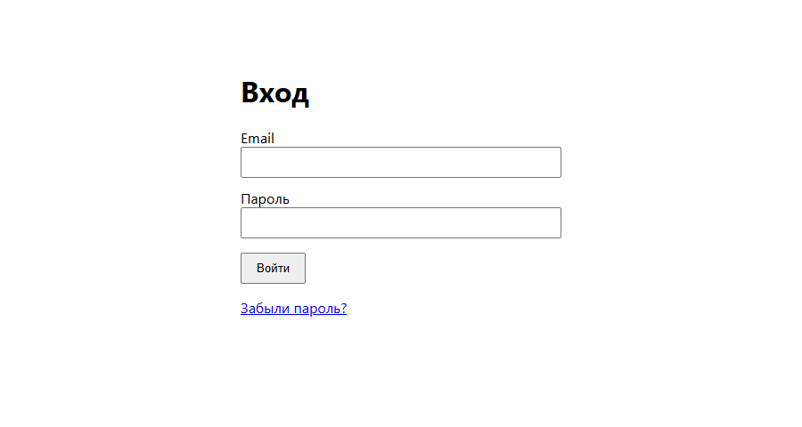

Учётные записи создаёт администратор: самостоятельной регистрации нет. Ваше имя справа вверху — ссылка на [профиль](#profile), рядом кнопка «Выйти».

После пяти неудачных попыток подряд вход временно блокируется. Подождите несколько минут или восстановите пароль.

### Первый вход

Пароль для первого входа задаётся одним из двух способов:

- **Временный пароль.** Его сообщает администратор. После входа система откроет страницу «Смена пароля»: введите временный пароль и дважды — новый. Вход продолжится с новым паролем.
- **Письмо-приглашение.** Откройте ссылку из письма «Приглашение в систему создания РПД и ФОС — задайте пароль» и задайте пароль. Ссылка действует трое суток и срабатывает один раз.

Пароль — не короче 8 символов, с заглавной и строчной буквой, цифрой и знаком (например, «-» или «!»). Новый пароль должен отличаться от временного.

### Забыли пароль

1. На странице входа нажмите «Забыли пароль?».
2. Укажите email учётной записи и нажмите «Отправить ссылку».
3. Откройте ссылку из письма, дважды введите новый пароль и нажмите «Задать пароль».

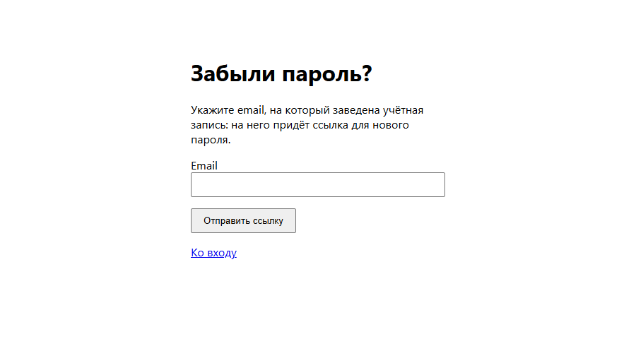

Ссылка действует сутки и срабатывает один раз. Страница отвечает одинаково на любой адрес: она не сообщает, зарегистрирован ли он. Если письма нет, проверьте папку «Спам» или попросите администратора задать временный пароль.

### Смена пароля

На странице профиля, раздел «Сменить пароль»: введите текущий пароль, новый и повтор, нажмите «Сменить пароль». Сеансы в других браузерах и на других компьютерах прекратятся, текущий продолжится.

## Профиль и уведомления

### Данные профиля

Профиль открывается щелчком по имени в шапке. ФИО, должность, подразделение и роли здесь только для чтения: ФИО, должность и подразделение исправляет методист или администратор в справочнике сотрудников, роли — администратор. Эти данные печатаются в документах: если в них ошибка, сообщите о ней до создания документа.

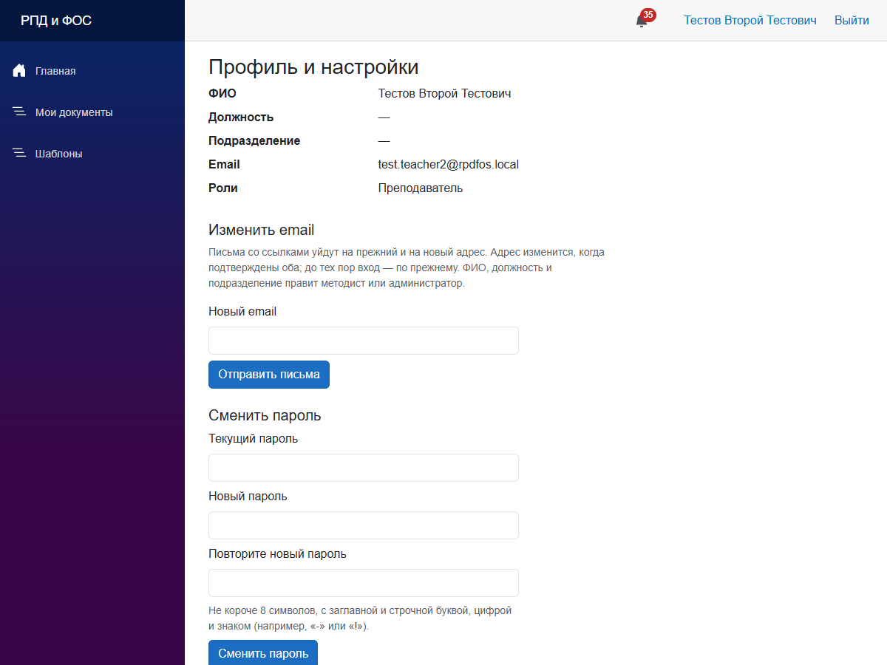

### Смена email

Email — это и адрес для писем, и имя для входа.

1. В разделе «Изменить email» укажите новый адрес и нажмите «Отправить письма». Письма со ссылками уйдут на прежний и на новый адрес.
2. Откройте ссылку в каждом письме и нажмите «Подтвердить».

Адрес изменится, когда подтверждены оба письма; до этого вход — по прежнему. В профиле видно, какое подтверждение система ждёт и до какого времени действуют ссылки. Новый запрос заменяет прежний.

Если к прежнему ящику доступа нет, обратитесь к администратору.

### Уведомления

Колокольчик в шапке показывает число непрочитанных уведомлений. Щелчок открывает список последних: «Открыть документ» переходит к документу и отмечает уведомление прочитанным, «Прочитано» только отмечает, «Прочитать все» отмечает все сразу. Список обновляется раз в минуту.

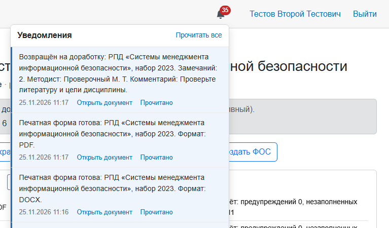

### Настройка уведомлений

В разделе «Уведомления» профиля у каждого события два независимых канала:

- **«В интерфейсе»** — показывать ли событие в колокольчике;
- **«Почта»** — «Сразу», «Раз в день» (одно письмо утром со всеми событиями) или «Выключено».

После изменений нажмите «Сохранить». По умолчанию в интерфейсе показываются все события, а письмом сразу приходят требующие действия: возврат на доработку, истекающий срок доработки, «Документ ждёт вашего согласования», передача документа, принудительная смена статуса.

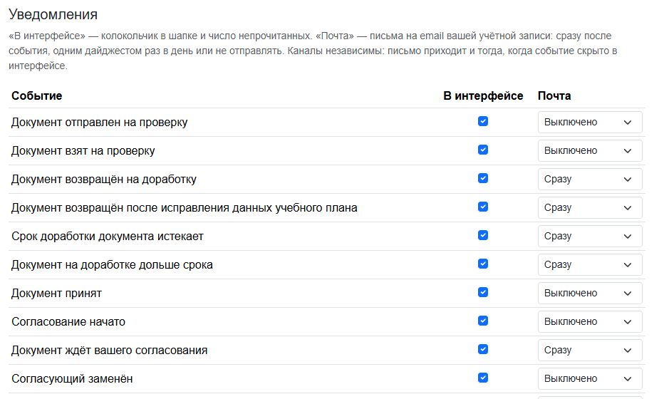

Если вместо таблицы написано, что учётная запись не связана со справочником сотрудников, обратитесь к администратору: без этой связи нельзя ни получать уведомления, ни создавать документы.

## Мои документы

### Список документов

Страница «Мои документы» показывает документы, автор которых — вы. Строка открывает документ. Над таблицей — отборы по статусу и учебному плану.

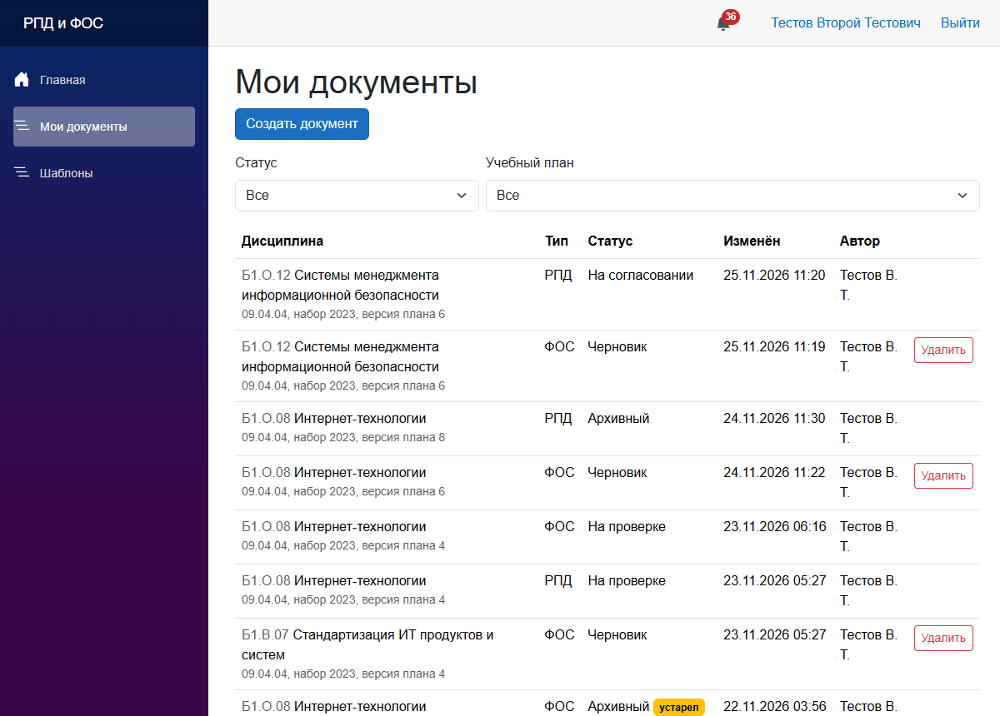

Таблица «Документы моих дисциплин» появляется, если методист закрепил за вами дисциплины. В ней — документы других авторов по этим дисциплинам, только для чтения.

### Удаление черновика

«Удалить» есть у своих документов в статусах «Черновик» и «Сохранённый черновик» — в строке списка и на странице документа. После подтверждения документ исчезнет из списков, и по дисциплине можно создать новый. Вернуть удалённый документ самостоятельно нельзя.

## Создание документа

### Создание РПД

1. На странице «Мои документы» нажмите «Создать документ».
2. Оставьте тип «РПД» и выберите опубликованный шаблон: в его названии указан учебный план.
3. В строке дисциплины нажмите «Создать РПД».

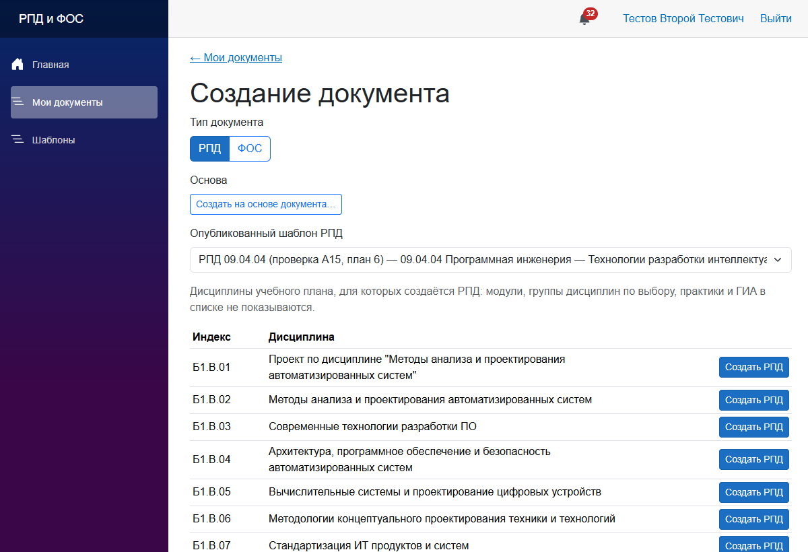

Документ откроется в редакторе. Титульный лист, место дисциплины в структуре программы, часы по семестрам, виды аттестации и компетенции уже заполнены из учебного плана и матрицы компетенций, вы указаны составителем.

Вместо кнопки в строке может быть пояснение:

| Что написано | Что делать |
| --- | --- |
| «Открыть документ» | РПД по этой дисциплине уже есть и открыта вам — продолжайте её |
| «РПД уже есть (автор — …)» | Документ ведёт другой преподаватель; передать его может методист |
| «Создают закреплённые преподаватели» | Дисциплина закреплена за другими — они названы под её названием; закрепления меняет методист |
| «Новый РПД — на основе согласованного» | У дисциплины есть согласованная РПД: следующая создаётся [на её основе](#create-based) |

Модули, группы дисциплин по выбору, практики и ГИА в списке не показываются: по ним документы не создаются. Если опубликованных шаблонов нет, их публикует методист.

### Создание на основе другого документа

Чтобы не вводить всё заново, создайте документ на основе прежнего — для той же дисциплины или для дисциплины другого учебного плана.

- **Из согласованного или архивного документа:** откройте его и нажмите «Создать на основе». Откроется страница создания, основа уже выбрана.
- **Со страницы создания:** нажмите «Создать на основе документа…», найдите основу по названию, дисциплине или автору и выберите её. Подходят свои документы и документы закреплённых за вами дисциплин, в любом статусе.

Затем выберите шаблон и в строке дисциплины нажмите «Создать на основе».

Переносится то, что вводил автор основы, в том числе часы. Если семестр новой дисциплины другой, перенесённые часы нужно поправить: виды самостоятельной работы с часами прежнего семестра удалите кнопкой «✕» и добавьте заново, у тем проверьте семестр и часы. Поля из учебного плана и справочников берутся заново. Номер и дату протокола кафедры нужно указать снова; если автор другой, его должность берётся из справочника.

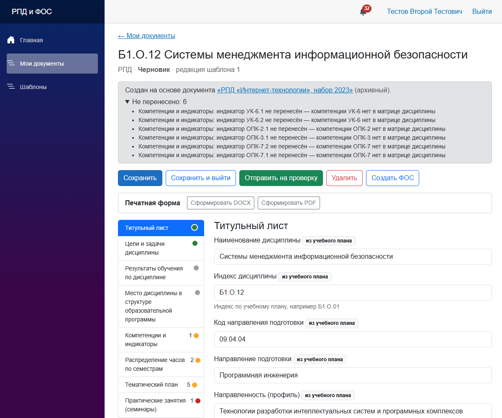

В новом документе сверху написано, на чём он основан, и перечислено всё, что не перенесено: например, индикатор, которого нет в матрице новой дисциплины. Пройдите по этому списку до отправки.

### Создание ФОС по РПД

ФОС создаётся по РПД дисциплины — не удалённой и не архивной. Создают его автор РПД и преподаватели, закреплённые за дисциплиной.

- **Из РПД:** откройте её и нажмите «Создать ФОС».
- **Со страницы создания:** выберите тип «ФОС» и шаблон ФОС. В таблице указано, по какой РПД создаётся ФОС. Если РПД нет, в строке написано «Сначала создайте РПД».

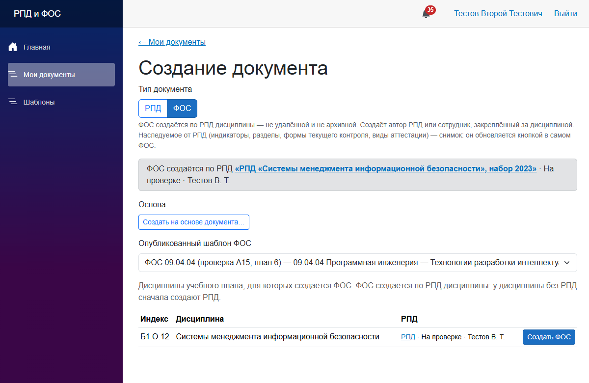

Индикаторы, разделы, формы текущего контроля и виды аттестации ФОС получает из РПД. Это снимок на момент создания: если РПД потом изменится, снимок обновляют [кнопкой «Обновить из РПД»](#fos-refresh).

Прежний ФОС тоже может быть основой: банк заданий, билеты, оценочные средства и шкала переносятся, а наследуемое берётся из РПД новой дисциплины.

## Редактор документа

### Устройство страницы

Сверху — название дисциплины, тип и статус, кнопки действий, панель «Печатная форма»; ниже — сообщения и замечания. Слева — разделы документа, справа — поля открытого раздела.

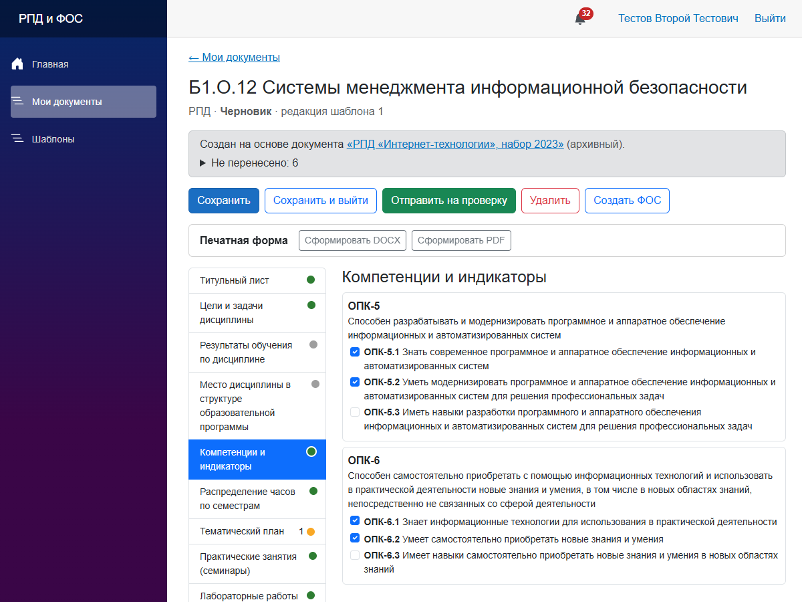

Круг у раздела показывает заполненность, число рядом — сколько обязательного не хватает:

| Круг | Что значит |
| --- | --- |
| Зелёный | Выполнено всё обязательное |
| Жёлтый | Выполнено частично |
| Красный | Не выполнено ни одного обязательного элемента |
| Серый | Обязательного нет или раздел не предусмотрен учебным планом |

Значок 💬 с числом — неразрешённые замечания в разделе. Раздел, которого нет в учебном плане дисциплины (например, «Лабораторные работы»), серый: вместо него напечатается стандартная формулировка, она показана в разделе.

### Поля

- Метка **«из учебного плана»** — поле заполнено системой, автор его не изменяет. Если значение неверное, сообщите методисту: он исправит поле на проверке.
- **Красная рамка** и подпись под полем — чего не хватает для отправки. Перечень по разделу стоит над полями: «Для отправки на проверку не хватает».
- **Жёлтый перечень** «Предупреждения (отправку не блокируют)» — то, на что обратит внимание методист.
- **✕** удаляет запись списка, **↑ и ↓** меняют порядок: они есть у литературы, ресурсов, программного обеспечения и материально-технического обеспечения. Порядок в форме — это порядок в печати.

Проверка раздела обновляется, когда вы выходите из поля.

### Сохранение

Документ сохраняется сам: раз в четыре минуты, при переходе в другой раздел и при уходе со страницы. Состояние видно справа от кнопок: «Есть несохранённые изменения», «Сохранение…», «Сохранено в 14:05».

- **«Сохранить»** — сохранить и сделать черновик «Сохранённым черновиком»; система запоминает версию документа.
- **«Сохранить и выйти»** — то же и переход к списку документов.

Незаполненный раздел сохранить можно. Раздел с неверными данными (например, с адресом ссылки без `https://`) не сохранится: сообщение укажет поле. Если закрыть вкладку с несохранёнными изменениями, браузер спросит подтверждение.

### Документ изменён в другой сессии

Если документ открыт в двух вкладках или на двух компьютерах и изменён в другом месте, появится сообщение «Документ изменён в другой сессии». Автосохранение остановится, введённое останется на экране.

1. Нажмите «Скопировать мой текст»: введённое в разделе попадёт в буфер обмена и в поле под кнопкой.
2. Нажмите «Перезагрузить документ».
3. Вставьте нужное в свежую версию.

Сообщение «Документ взят на проверку методистом» значит, что методист забрал документ: изменить его можно будет после возврата на доработку.

### Форматированный текст и таблицы

Поля с панелью кнопок принимают полужирный, курсив, списки, таблицы и рисунки. Шрифт, цвет, ширина и выравнивание не сохраняются: оформление задаёт шаблон. Текст из Word вставляется обычной вставкой.

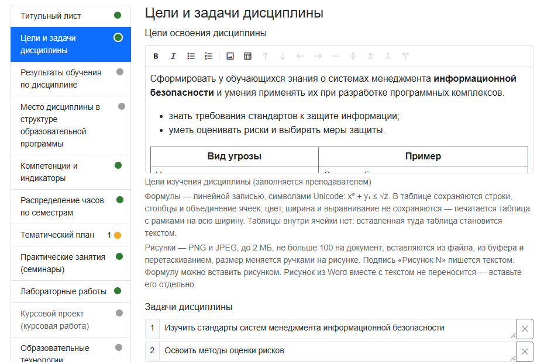

- **Таблица:** кнопка «Таблица», число строк и столбцов, «Строка заголовка». Строки, столбцы и объединение ячеек — кнопками панели или правой кнопкой мыши в ячейке. Таблицы внутри ячейки не бывает. Печатается таблица с рамками на всю ширину.
- **Формулы** пишутся линейной записью символами: x² + y₁ ≤ √z. Сложную формулу вставьте рисунком.

### Рисунки

Рисунки принимаются в форматах PNG и JPEG, до 2 МБ каждый, не больше 100 на документ. Вставить рисунок можно кнопкой «Рисунок» (из файла), из буфера обмена или перетаскиванием файла в текст. Размер меняется ручками на рисунке. Подпись «Рисунок 1 — …» пишется текстом под рисунком.

Рисунок из Word вместе с текстом не переносится: скопируйте и вставьте его отдельно. В экзаменационных билетах рисунков нет.

## Разделы РПД

Разделы перечислены в порядке редактора. Состав полей зависит от шаблона: у документов по прежним шаблонам некоторых полей нет.

### Титульный лист

Заполняется из учебного плана и справочников: дисциплина, направление, профиль, уровень, форма обучения, кафедра, учебный год. Автор ничего не вводит.

### Цели, задачи и результаты обучения

«Цели освоения дисциплины» — форматированный текст, «Задачи дисциплины» — список, не меньше одной. «Результаты обучения по дисциплине» — «Знать», «Уметь», «Владеть» — необязательны.

### Место дисциплины в структуре программы

Индекс, блок и часть — из плана. Предшествующие и последующие дисциплины отмечаются флажками в списке из учебного плана: предшествующие — с более ранних семестров, последующие — с более поздних. Если таких дисциплин в плане нет, показана формулировка, которая напечатается вместо списка. «Предварительные результаты обучения» описывают, что студент должен уметь до начала дисциплины.

### Компетенции и индикаторы

Компетенции взяты из матрицы для этой дисциплины. Отметьте индикаторы, которые дисциплина формирует: у каждой компетенции — хотя бы один. От этого выбора зависят индикаторы у тем, а потом и ФОС.

### Распределение часов по семестрам

Часы и виды аттестации — из плана. Автор заполняет «Виды самостоятельной работы»: вид, обозначение (например, «Р» — реферат), часы по семестрам. Строка «Сумма видов / самостоятельная работа по распределению часов» становится зелёной, когда сумма совпала. Флажок «Разделы» позволяет отметить номера разделов: они напечатаются после названия вида («самостоятельное изучение разделов 1, 3»).

### Тематический план

Запись — тема. У темы указываются:

- **«Раздел»** — номер раздела;
- **«Наименование раздела»** — одинаковое у всех тем раздела, печатается в таблицах 3.1 и 3.2 и в паспорте ФОС;
- **«Семестр»** — если дисциплина читается в нескольких семестрах; при одном семестре поля нет;
- **«Неделя семестра»** — номер, диапазон или перечень: 3; 1–4; 5, 6;
- **«Тема»** и **«Содержание»**;
- **часы** по видам занятий; «–» значит, что такого вида занятий в семестре нет;
- **индикаторы** — из отмеченных в разделе «Компетенции и индикаторы»;
- **«Формы текущего контроля»** — свои и отмеченные из видов самостоятельной работы.

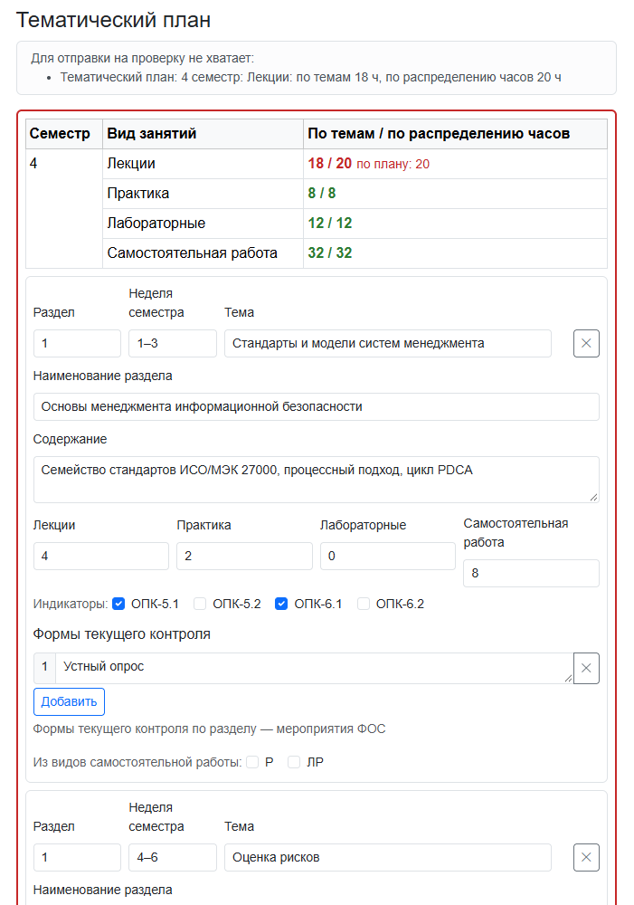

Таблица над темами сверяет часы «по темам» с часами «по распределению часов». Красное число с подписью «по плану» — расхождение: с ним документ не отправить.

### Практические занятия и лабораторные работы

Раздел есть, если занятия предусмотрены планом; тогда нужна хотя бы одна запись. № — номер, диапазон или перечень: 3; 1–2; 4, 5. Итог часов внизу таблицы должен совпасть с планом.

### Курсовой проект (курсовая работа)

Раздел есть, если курсовое проектирование предусмотрено планом. Вид — из плана; «Примерные темы» — не меньше одной; «Требования» необязательны.

### Образовательные технологии и оценочные средства

«Образовательные технологии» — список методов обучения. «Оценочные средства» — краткий перечень для текущего контроля и промежуточной аттестации; подробно они описываются в ФОС.

### Учебно-методическое обеспечение

- **Основная литература** — не меньше одной записи. По Положению о рабочих программах нужно не меньше трёх, а издание не старше 10 лет: иначе — предупреждение. Классический учебник отметьте флажком «Фундаментальное издание» — предупреждения о годе не будет.
- **Дополнительная литература, периодические издания, интернет-ресурсы.** Библиографическая запись — по ГОСТ Р 7.0.100–2018. Поле «Ссылка» — адрес в электронной библиотеке.
- **Методические указания** — текст, ссылка или и то и другое: к лабораторным, практическим занятиям, к курсовому проектированию и самостоятельной работе.
- **Программное обеспечение** и часть ресурсов могут быть заранее заполнены постоянными пунктами университета из шаблона: их можно изменить.

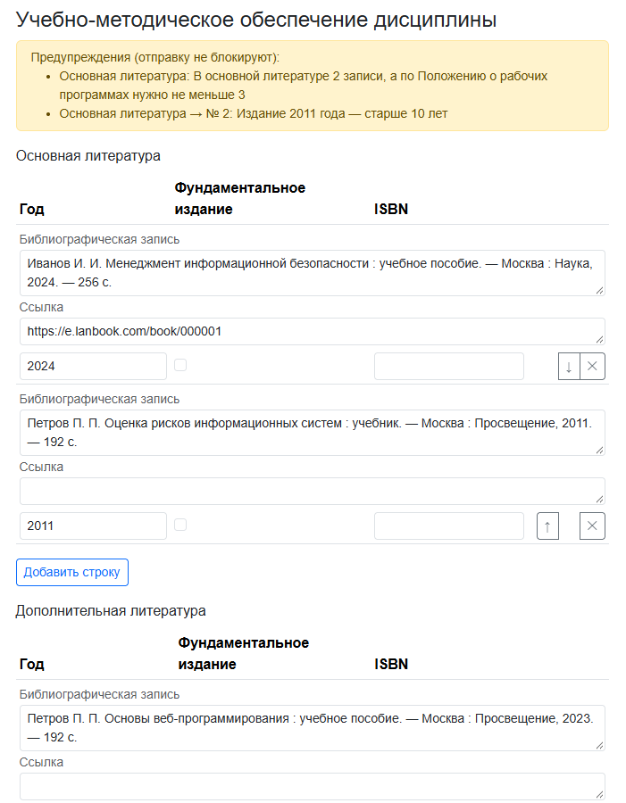

### Материально-техническое обеспечение и дополнительный раздел

«Материально-техническое обеспечение» — помещения и оборудование списком. «Дополнительный раздел» необязателен: заголовок и текст пишет автор, без текста он не печатается.

### Лист согласования

- **Составители.** Вы уже в списке. Чтобы добавить коллегу, введите фамилию, нажмите «Найти», затем «Добавить». Имя и должность можно поправить; если должности нет в справочнике, введите её. Порядок составителей — порядок в печати.
- **Протокол заседания кафедры** — номер и дата. Отправить документ можно и без них, но заполните их, как только заседание прошло: они печатаются в документе.

Подписантов вводить не нужно: система берёт их из справочника сотрудников.

## Разделы ФОС

Титульный лист и лист согласования устроены как в РПД.

### Связь с РПД и индикаторы

Компетенции с индикаторами, разделы дисциплины и виды аттестации — снимок РПД, только для чтения.

### Обновление из РПД

Если РПД изменилась, над разделами появится метка «РПД изменилась» и кнопка «Обновить из РПД». Она заменит снимок нынешними данными РПД. Паспорт и оценочные средства останутся как есть: сообщение назовёт, что исчезло из РПД и что проверить, а строки с исчезнувшими разделами и индикаторами станут красными.

### Банк заданий

Заполните банк до паспорта: паспорт ссылается на задания.

1. «Добавить группу»: название («Вопросы к зачёту», «Раздел 1»), вид («Вопросы», «Задания», «Тесты»), контроль (текущий или промежуточная аттестация), семестры. У группы тестов обязателен раздел РПД.
2. «Добавить задание»: текст, при необходимости — ожидаемый ответ, балл и индикаторы. У теста варианты ответов пишутся списком в тексте, а верные — в поле «Ожидаемый ответ».

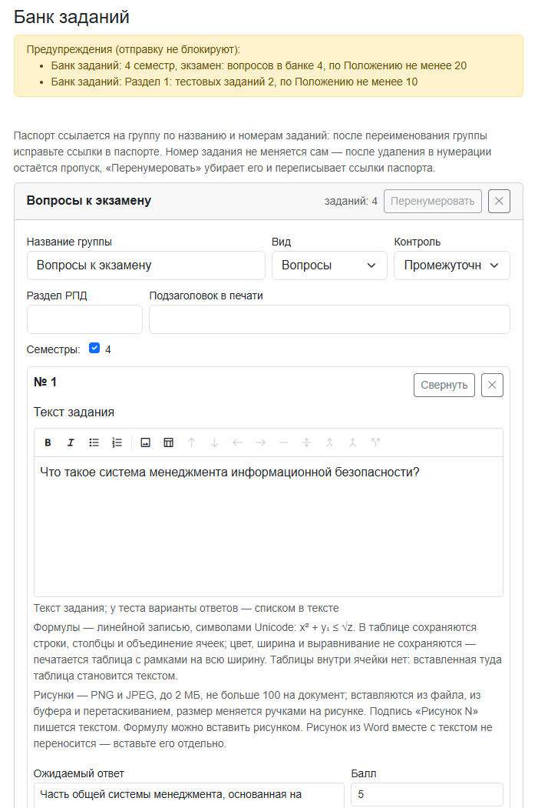

Задания свёрнуты до строки; «Править» открывает задание. Номер задания сам не меняется: после удаления остаётся пропуск. «Перенумеровать» делает номера сплошными и переписывает ссылки паспорта. Если вы переименовали группу, исправьте ссылки в паспорте.

> «✕» у задания удаляет его сразу, без вопроса. Удаление группы система переспрашивает.

### Паспорт ФОС

Две таблицы: «раздел — компетенции — задания» и «индикатор — разделы РПД — задания». Кнопки «Добавить разделы из РПД» и «Добавить индикаторы из РПД» дописывают недостающие строки, ничего не меняя.

Ссылка на задания: выберите группу, первое и последнее задание и нажмите «Добавить». Вместо номера можно оставить «все» — вся группа. Красная ссылка — такой группы или номера в банке больше нет.

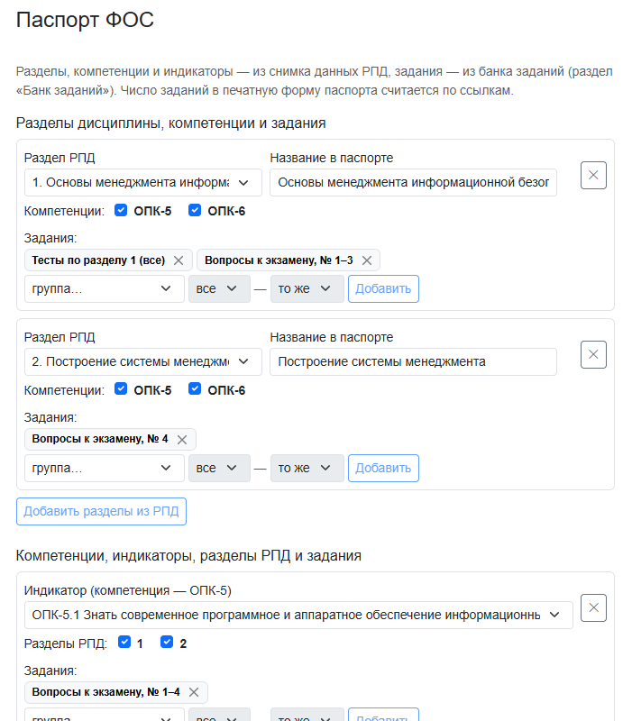

Число заданий в печати считается по ссылкам: вводить его не нужно.

### Текущий контроль

«Формы текущей аттестации» и «Мероприятия текущего контроля по модулям» должны покрывать формы контроля из РПД: иначе — предупреждение. «Программы и типовые варианты» и «Модульно-рейтинговые атрибуты» необязательны.

### Оценочные средства

Раздел необязателен. Средство — это тип, наименование, индикаторы, описание и критерии оценок. «Предложить» подберёт типовые средства для индикаторов, у которых средств ещё нет, по формам контроля, видам занятий и аттестации РПД: проверьте предложенное. Наверху перечислены индикаторы без средства.

### Экзаменационные билеты

Раздел необязателен. «Добавить билет», в билете — не меньше двух вопросов; «Добавить вопрос» добавляет ещё.

### Критерии формирования оценок

Вид шкалы: «Балльная (5)», «Зачёт / незачёт» или «100-балльная» — по виду аттестации РПД. Пустой раздел печатается типовыми критериями.

## Проверка документа системой

Система проверяет документ при вводе и полностью — при отправке. **Ошибки** не дают отправить документ, **предупреждения** отправку не блокируют: решает методист.

### Ошибки и предупреждения РПД

| Что проверяется | Уровень |
| --- | --- |
| Заполнены обязательные поля; в предусмотренном планом разделе есть хотя бы одна запись | Ошибка |
| Часы по темам, практическим и лабораторным занятиям совпадают с распределением часов | Ошибка |
| Сумма видов самостоятельной работы по семестру совпадает с планом | Ошибка |
| У каждой компетенции выбран индикатор; компетенции есть в матрице дисциплины | Ошибка |
| Коды компетенций не повторяются | Ошибка |
| Наименование раздела одинаковое у всех его тем | Ошибка |
| Год издания — не позже текущего | Ошибка |
| В записи методических указаний есть текст или ссылка; у дополнительного раздела с текстом есть заголовок | Ошибка |
| Каждый индикатор есть хотя бы в одной теме | Предупреждение |
| Контактная работа, контроль и самостоятельная работа семестра в сумме дают его зачётные единицы (36 ч каждая) | Предупреждение |
| Основной литературы не меньше трёх записей, издания не старше 10 лет | Предупреждение |
| Поле отличается от учебного плана (его исправил методист) | Предупреждение |

### Ошибки и предупреждения ФОС

| Что проверяется | Уровень |
| --- | --- |
| Заполнены обязательные поля; коды компетенций не повторяются | Ошибка |
| Связанная РПД — на проверке, принята, на согласовании или согласована | Ошибка |
| Паспорт согласован с банком и РПД: ссылки ведут на существующие задания, разделы есть в РПД, у индикаторов есть задания, номера без пропусков | Предупреждение |
| У каждого индикатора есть оценочное средство | Предупреждение |
| Формы текущего контроля РПД есть в ФОС | Предупреждение |
| Средства и шкала соответствуют виду аттестации РПД | Предупреждение |
| Положение о ФОС: не меньше 20 вопросов к каждому виду аттестации в семестре, 10 тестовых заданий на раздел с тестами, 25 билетов к экзамену (или группа тестов промежуточной аттестации), критерии у каждого средства | Предупреждение |

### Сквозная проверка РПД ↔ ФОС

Вверху ФОС блок «Сквозная проверка РПД ↔ ФОС» перечисляет расхождения ФОС с нынешней РПД; ссылка справа от строки ведёт в нужный раздел. На странице РПД у каждого её ФОС показано число расхождений. РПД от ФОС не зависит: расхождения исправляют в ФОС.

## Отправка, замечания и согласование

### Отправка на проверку

Нажмите «Отправить на проверку». Если есть ошибки, документ не отправится, а сообщение перечислит их: щелчок по названию поля открывает его раздел.

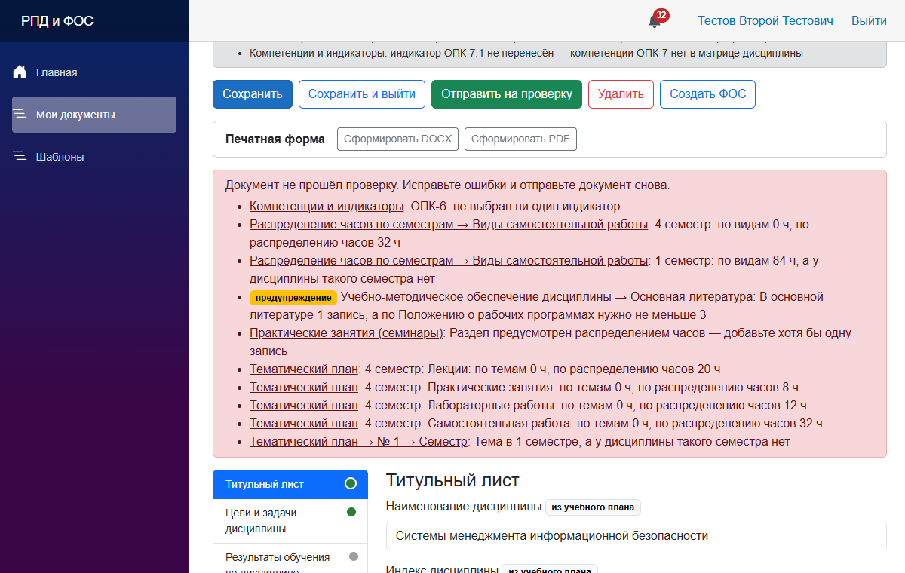

После отправки документ у методиста: вы его читаете и печатаете, но не изменяете. Методист может взять документ на проверку и сам, не дожидаясь отправки, — об этом придёт уведомление с причиной.

ФОС отправляется, когда его РПД уже отправлена.

### Доработка по замечаниям

Если методист вернул документ, статус — «На доработке», приходит уведомление. Под кнопками — список «Замечания к полям», у разделов — значок 💬 с числом, само замечание — у поля.

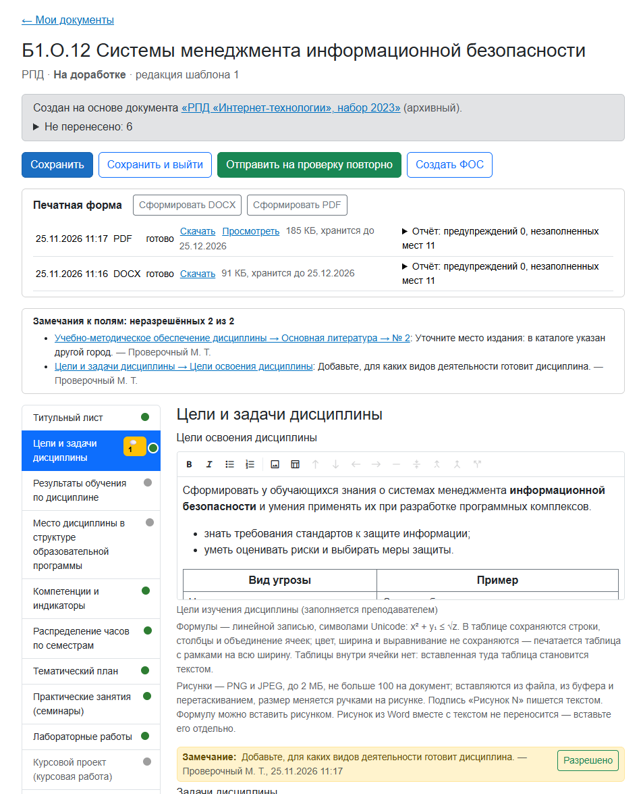

1. Щёлкните по замечанию в списке: откроется поле.
2. Исправьте и нажмите «Разрешено» у замечания.
3. Когда всё исправлено, нажмите «Отправить на проверку повторно».

Замечание к записи списка (литературе, теме, заданию) остаётся у своей записи, даже если вы переставили или вставили другие. Если запись удалить, замечание останется в общем списке с меткой «запись удалена» — снимите его там.

Принять документ с неразрешёнными замечаниями методист не может, поэтому отмечайте каждое.

> На доработку отводится 14 дней. За 3 дня до срока приходит напоминание, после срока о задержке узнают методисты и заведующий кафедрой.

### Приём и согласование

Когда методист принимает документ, система находит согласующих по справочнику и начинает согласование. Все согласующие отмечают документ независимо, порядок не важен. Панель «Согласование» показывает места, согласующих, отметки, время и комментарии.

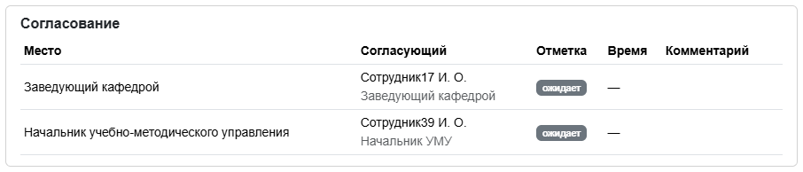

- **РПД** электронно согласуют заведующий кафедрой и начальник учебно-методического управления.
- **ФОС** — председатель учебно-методической комиссии направления и начальник учебно-методического управления.

Остальные подписи листа согласования ставятся на бумаге. Согласующий может вернуть документ методисту; методист исправит его сам или вернёт вам. После нового приёма согласование начинается заново — для всех.

Отметки отменённого круга показаны серым с подписью «Круг отменён».

### Согласованный документ вернули

Методист может вернуть согласованный документ на исправление — автору приходит уведомление с причиной. Документ снова «На проверке», согласование придётся пройти заново. В нештатных случаях статус меняет администратор, тоже с уведомлением.

## Печать

### Формирование DOCX и PDF

На странице документа, панель «Печатная форма»: «Сформировать DOCX» или «Сформировать PDF». Автор печатает документ в любом статусе. Открытый раздел перед этим сохраняется.

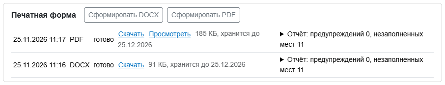

Формирование идёт в фоне: «в очереди» → «формируется» → «готово». Страницу можно закрыть: о готовом файле придёт уведомление. Готовый PDF сразу открывается для просмотра. «Скачать» сохраняет файл; имя — «Тип_Дисциплина_Период». Файлы хранятся 30 дней, затем документ формируют заново.

### Отчёт о формировании

Если что-то не подставилось, у файла есть «Отчёт»: предупреждения (например, подписанта нет в справочнике) и незаполненные места. Места названы техническими именами — закладкой файла оформления и путём поля: `AutofillPeriodicals1 — поле /literature/periodicals не заполнено` означает, что не введены периодические издания. Незаполненное необязательное поле — не ошибка: место печатается пустым. Нужное место допишите в редакторе и сформируйте файл снова или заполните в скачанном DOCX.

Оглавление РПД система строит сама по печатаемым разделам, номера страниц в DOCX и PDF уже проставлены. Если вы правили скачанный DOCX, обновите оглавление в Word.

## Архив и устаревшие документы

### Отправка в архив

Согласованный документ, который больше не нужен в работе, отправляют кнопкой «В архив» автор, методист или администратор. Архивный документ — только для чтения: его можно печатать и брать основой, а по дисциплине можно создать новый документ. Вернуть документ из архива может только администратор.

Согласованные ФОС уходят в архив вместе с РПД. Если по РПД есть незавершённый ФОС, система не отправит её в архив и назовёт этот ФОС: сначала согласуйте или удалите его.

### Устаревший документ

Метка «устарел» появляется, когда вышла новая редакция шаблона или согласован документ, созданный на основе этого. Вместе с РПД устаревают её согласованные ФОС. Автору приходит уведомление «Документ устарел», если согласован преемник.

Статус при этом не меняется: устаревший документ действует, пока его не отправят в архив.

## Чтение чужих документов

Только для чтения вам открыты:

- **ФОС по вашей РПД** — кто бы их ни создал: ссылки — в блоке «ФОС по этой РПД» на странице РПД;
- **РПД вашего ФОС** — ссылка в блоке «Создан по РПД» на странице ФОС;
- **документы закреплённых за вами дисциплин** — таблица «Документы моих дисциплин»;
- **документы, где вы согласующий** — со страницы «Согласование».

Остальные документы других авторов вам не открыты. Если документ передали другому автору, прежний автор его больше не видит.

## Согласующему

Раздел для тех, у кого есть роль «Утверждающий»: заведующего кафедрой, начальника УМУ, председателя УМК направления. [Вход](#login), [профиль и уведомления](#profile) — как у преподавателя.

### Очередь согласования

Страница «Согласование» показывает два списка:

- **«Ждут вашей отметки»** — документы, которые нужно согласовать или вернуть; сверху те, что отправлены раньше. О новом документе приходит уведомление, по умолчанию и письмо.
- **«Отмеченные мной»** — документы, где ваша отметка уже стоит, с нынешним статусом документа.

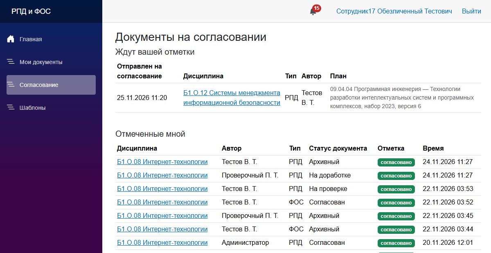

Если вы ещё и преподаватель, меню содержит и «Мои документы».

### Чтение документа

Щёлкните по дисциплине. Документ открыт для чтения: слева разделы, справа их содержание. Панель «Согласование» показывает отметки остальных, ваша строка — с меткой «вы». Удобнее читать печатную форму: нажмите «Сформировать PDF» — готовый файл откроется на этой же странице.

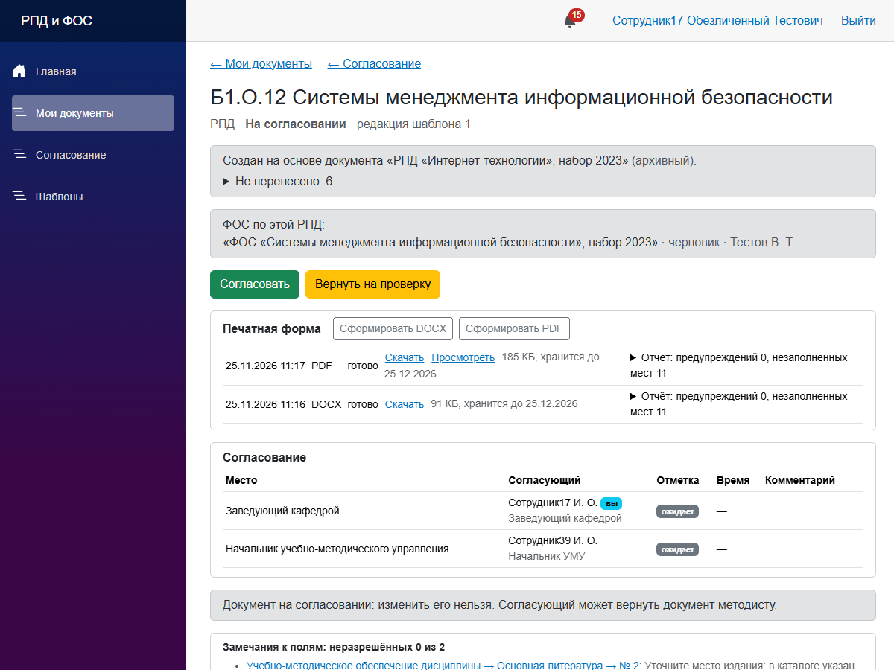

### Замечания к полям

Под каждым полем есть «+ замечание»: напишите, что нужно исправить, и нажмите «Добавить замечание». У списка можно выбрать, к чему замечание: «к полю целиком» или к отдельной записи.

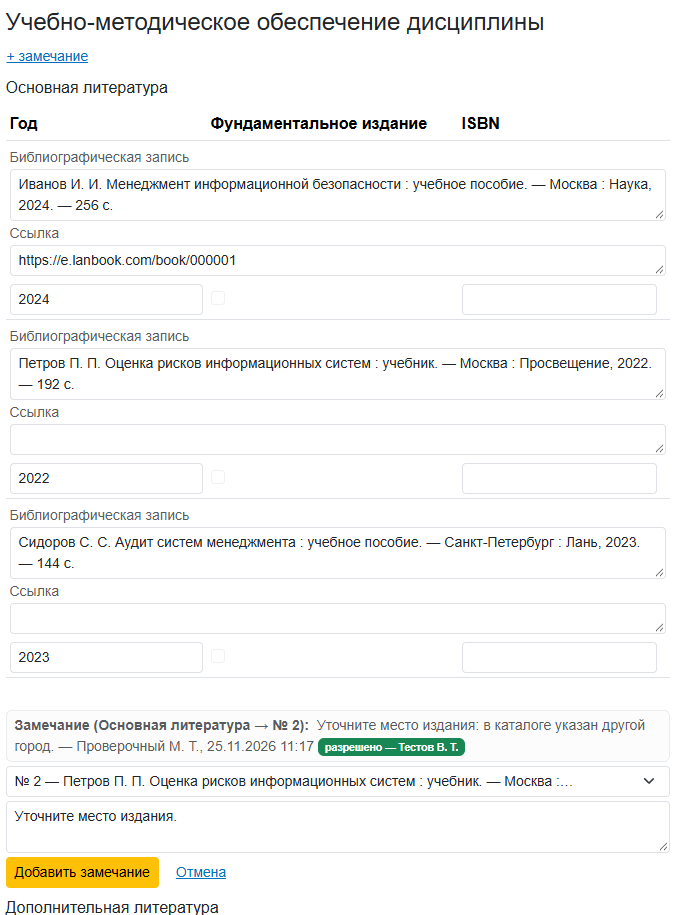

Замечания оставляют до своей отметки. Своё замечание можно снять кнопкой «Разрешено».

### Согласовать

Нажмите «Согласовать» и подтвердите. Отозвать отметку нельзя. Когда отметились все, документ становится «Согласован».

Пока есть ваши неснятые замечания, согласовать документ нельзя: снимите их или верните документ.

### Вернуть на проверку

1. Нажмите «Вернуть на проверку».
2. Напишите комментарий — он обязателен, его увидит методист — и нажмите «Вернуть».

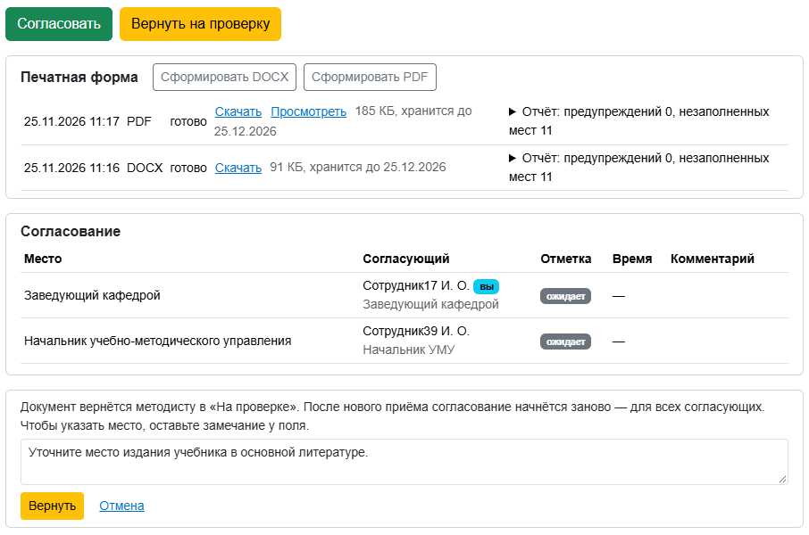

Документ вернётся методисту, а не автору: методист решит, исправить самому или вернуть автору. Круг согласования прервётся для всех, и после нового приёма его пройдут заново. Остальным согласующим, чья отметка ждала, придёт уведомление «Круг согласования прерван».

### Если документа нет в очереди

- Документ уже отметили — он в списке «Отмеченные мной».
- Круг прерван — документ вернулся методисту; после нового приёма он снова появится.
- Вас заменили другим согласующим — об этом было уведомление «Согласующий заменён».
- Вместо списков сообщение об ошибке — учётная запись не связана со справочником сотрудников: обратитесь к администратору.

## Сообщения системы

| Сообщение | Что делать |
| --- | --- |
| «Неверный email или пароль.» | Проверьте раскладку и регистр; если не помогло — «Забыли пароль?» |
| «Учётная запись временно заблокирована после нескольких неудачных попыток.» | Подождите несколько минут или восстановите пароль |
| «Учётная запись отключена администратором.» | Обратитесь к администратору |
| «Нет доступа» | У роли нет этой страницы или документ вам не открыт; если доступ нужен, обратитесь к методисту |
| «Нет связи с сервером. Повторите позже.» | Не закрывайте страницу: введённое на экране. Повторите, когда связь вернётся |
| «Документ изменён в другой сессии.» | См. [«Документ изменён в другой сессии»](#editor-conflict) |
| «Документ взят на проверку методистом» | Документ у методиста; изменения — после возврата на доработку |
| «Документ не прошёл проверку» | Исправьте перечисленное и отправьте снова |
| «Раздел заполнен с ошибками» | Исправьте указанные поля: раздел с неверными данными не сохраняется |
| «Дисциплина закреплена» | Документ создают закреплённые преподаватели; закрепления меняет методист |
| «Есть незавершённый ФОС» | РПД не уходит в архив, пока по ней есть незавершённый ФОС |
| «Рисунок не вставлен» | Проверьте формат (PNG, JPEG), размер (до 2 МБ) и связь |
| «Файл удалён по сроку хранения — сформируйте документ заново.» | Сформируйте файл ещё раз |
| «Печатная форма не сформирована» | В уведомлении и в списке файлов названа причина; повторите, а если не помогло — сообщите администратору |
